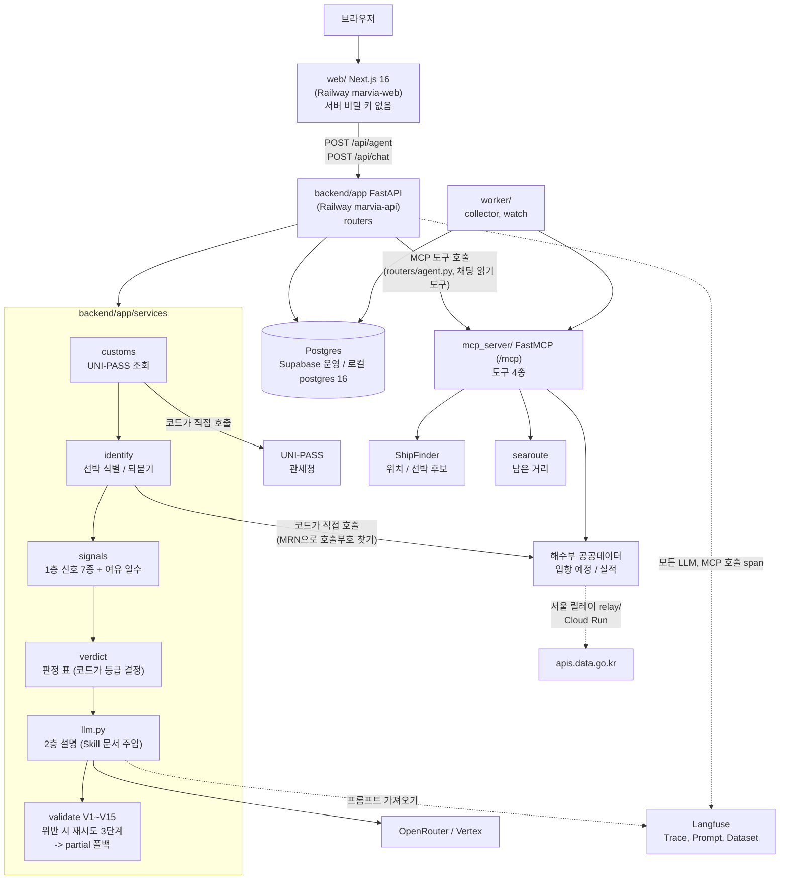

# Marvia (마르비아)

**B/L 하나로 내 화물이 제때 오는지 순항 / 주의 / 긴급으로 판정하고, 왜 그런지 근거까지 보여주는 LLM 에이전트.** 부산항 수입 화물 대상.

KDT AI Human 7기 2차 팀 프로젝트 · 5조 · [유형 1] 도메인 특화 LLM 서비스

## 서비스 주소

| | |
|---|---|
| 서비스 | https://marvia.up.railway.app (Railway `marvia-web`) |
| Agent API | https://marvia-api-production.up.railway.app (Railway `marvia-api`) · `GET /health` · `POST /api/agent` |
| MCP | 위 API 주소의 `/mcp` (Bearer 토큰) |
| 문서 | [docs/README.md](./docs/README.md) (기획 PRD · 설계 SDD · 작업 리스트 · ERD · 근거 자료) |
| 지표 | [EVAL_REPORT.md](./EVAL_REPORT.md) |

주소는 `docs/release_manifest.json`에 적힌 값이다. 배포는 Railway이고 Vercel은 쓰지 않는다.

**지금 살아있는지 확인**

브라우저로는 아래 주소를 열면 된다. 터미널에서는 `curl`로 같은 주소를 부른다.

| 방법 | 주소 또는 명령 |
|---|---|
| 브라우저 | https://marvia-api-production.up.railway.app/health |
| 터미널 | `curl -s https://marvia-api-production.up.railway.app/health` |
| API 문서 (브라우저) | https://marvia-api-production.up.railway.app/docs |

| 결과 | 뜻 |
|---|---|
| `{"status":"ok","db":"ok"}` | API와 DB가 모두 응답한다 |
| HTTP 503 | API는 떠 있고 DB 연결이 끊겼다 (`/health`가 DB를 확인한다) |
| 주소만(`/`) 열면 `Not Found`, `/api/agent`를 브라우저로 열면 `Method Not Allowed` | 정상이다. API 서버라 첫 화면이 없고, `/api/agent`는 B/L을 보내는 POST 요청만 받는다. 화면은 위 표의 웹 주소에서 쓴다 |
| 응답 없음 · 타임아웃 | 배포 서버가 내려가 있다. 로컬에서 [키 없이 데모](#키-없이-데모-13건-10분-재현)로 같은 화면과 판정을 재현할 수 있다 |

## 데모

화면 데모 모드(`NEXT_PUBLIC_API_BASE` 비움, 가공 데이터 `MRVDEMO..`)를 실제로 조작해 녹화했다. 실제 B/L은 나오지 않는다.

| 구간 | 무엇을 보여주나 | GIF |
|---|---|---|
| 01 | B/L 조회 -> 판정(순항/주의/긴급)과 근거 |  |
| 02 | 배를 확정 못 할 때 되묻기와 후보 칩 |  |
| 03 | 채팅 후속 질문(통관 단계, 다음 할 일) |  |
| 04 | 지켜보기 지도 |  |
| 05 | 서류 사진 첨부 흐름 (데모 모드는 사진 내용과 관계없이 가공 B/L을 돌려준다) |  |
| 06 | 화물 현황표 |  |

파일 경로: `docs/assets/gif/01-lookup.gif` ~ `06-cargo-sheet.gif`.

**목표 대비 결과:** 평가 목표와 달성 여부는 [EVAL_REPORT.md](./EVAL_REPORT.md), 아래 [지표](#지표)에 이 레포에서 돌린 숫자가 있다.

---

## 문제와 해결

포워더가 일일이 챙겨주지 않는 소량 해상 수입자(스마트스토어 수입 셀러, 구매대행)는 부산항으로 들어오는 화물 몇 건을 직접 관리한다. 추적 서비스에 ETA가 떠 있어도 **그 값을 믿어도 되는지, 그 배가 내 배가 맞는지, 유니패스 통관 단계가 무슨 뜻인지** 판단하지 못한다. 그래서 포워더 문의와 직접 확인에 시간을 쓰고, 지연을 늦게 알아 판매 일정이 틀어진다.

실제 AIS 데이터는 자주 깨져 있다. ShipFinder 응답에서 직접 확인한 사례는 다음과 같다.

| 사례 | 문제 |
|---|---|
| 53일 전 위치를 현재 위치처럼 반환 | 오래된 값을 믿게 됨 |
| 같은 선명으로 검색하면 국적이 다른 동명 선박이 섞임 | 남의 배를 내 배로 착각 |
| IMO 하나에 MMSI 2개 | 식별 불확정 |
| 목적지가 "XX QZQZZZZZ"처럼 깨짐 | 목적지 신뢰 불가 |
| 항해상태는 "항해 중"인데 속도 0 | 신호끼리 어긋남 |

팀원이 해군 함정에서 AIS·항해 상태·입출항 절차를 직접 다뤘고, 이 판독 경험이 판정 기준(Skill)이 된다. 군함 데이터는 기밀이라 같은 해운 도메인의 상선 공개 데이터로 대입했다.

B/L 번호와 판매 예정일을 넣으면, 선박을 식별하고 신호를 판정해 3단계 판정과 할 일, 근거를 돌려준다. 확정할 수 없으면 판정하지 않고 되묻는다. 모든 판정에 출처와 조회 시각이 붙는다.

```
입력   B/L 번호 + 판매 예정일 10/20

출력   주의
        근거  AIS ETA 10/14 vs 해수부 입항예정 10/15 09:00 → 12시간 넘게 차이
              해수부 관제 정보를 우선해 신뢰 ETA 10/15, 판매 예정일까지 여유 5일
        할 일 10/13에 다시 확인. 입항예정이 10/18 이후로 밀리면 판매 일정 조정
        통관  "입항 전" 단계, 입항 후 수입신고 → 심사 → 수리 순서
        근거 카드  ShipFinder 위치 (조회 시각) · 해수부 입항예정 (조회 시각) · UNI-PASS (조회 시각)

되묻기 선명 "TEST PAN"(가상) 후보 3척, 국적·목적지로도 확정 불가
        → 판정 없이 "항차 번호나 포워더가 알려준 ETA를 알려주세요"
```

(위 출력은 형식 예시이다. 실제 값은 조회 결과에 따라 달라진다.)

| 판정 | 대표 상황 |
|---|---|
| 긴급 | 정박 24시간+, 목적지가 부산 아님, 통관 검사 지정, 신뢰 ETA가 판매 예정일을 넘김 |
| 주의 | 신호 하나 triggered인데 여유 일수 남음 |
| 순항 | 모든 신호 clear, ETA 근거 2개 이상 일치 |
| 판정 보류 | 선박 식별 불확정 또는 위치 없음 -> 물을 것 1개 이상 |

유사 서비스(트레드링스)와 다른 점은 **선박 식별 되묻기**와 **신호 상충 해석** 둘이다. 조회한 배가 내 배라고 전제하지 않고, ETA 확률 범위 대신 왜 못 믿는지 근거를 보여준다. 비교 전체는 [PRD 3장](./docs/Marvia_PRD.md)에 있다.

### 만들지 않는 것

항공·육상·부산 외 항만, 창고 수령일 예측, 세액·통관 가부 판단, 결제. 알림은 카카오톡 "나에게 보내기"만 만들었고 이메일·푸시 알림과 알림톡은 만들지 않는다. 서류는 사진과 PDF를 받는다. 범위 전체는 [PRD 4절](./docs/Marvia_PRD.md).

---

## 아키텍처



처리 단계는 `POST /api/agent` 기준이다. 단계별 입출력과 실패 처리는 [SDD 4절과 8절](./docs/Marvia_SDD.md).

| 단계 | 하는 일 | 누가 |
|---|---|---|
| 1 validate | B/L 형식, 판매 예정일(선택) 검증 | 코드 |
| 2 customs | UNI-PASS 조회 -> 선명·국적·통관 단계 | 코드 |
| 3 identify | 후보 1척이면 확정. 여럿이면 선택, 확정 불가면 되묻기 | 코드 + LLM(선택만) |
| 4 collect | 위치·입항예정·남은 거리 | MCP 도구 |
| 5 signals | 1층 신호 7종 (7번째는 판매 예정일이 있을 때) | 코드 |
| 6 margin | 판매 예정일까지 여유 일수 | 코드 |
| 7 judge | 2층 판정 설명·할 일·통관 해설 | LLM (등급은 코드의 판정 표) |
| 8 validate | 출력 검증 규칙, 위반 시 재시도 3단계 | 코드 |

결과는 `AgentResponse` (ok / partial / insufficient / failed)로 나가 화면에 판정·할 일·위치·통관 해설·하역 장소·근거 카드로 그려진다. 채팅(`POST /api/chat`)은 이 흐름 앞에 붙은 자연어 창구라서, B/L이 담긴 문장이면 같은 판정 흐름을 부른다. 대화 목록·기억·지켜보기·카카오톡 알림도 이 창구와 `/api/*` 라우터가 맡는다.

### 설계 원칙

| 원칙 | 내용 |
|---|---|
| 판정은 2층 | 1층은 코드가 신호 7종(위치 6시간 끊김, AIS ETA와 해수부 예정 12시간 차이, 부산 인근 24시간 정박, 목적지 변경·깨짐, 항해상태·속도 불일치, 통관 검사·보류, 신뢰 ETA가 판매 예정일을 넘김)을 triggered / clear / unknown으로 판정한다. 2층은 LLM이 신호가 어긋날 때 어느 출처를 왜 믿는지 설명한다 |
| 숫자는 코드가 계산 | 여유 일수, 거리, freshness는 코드가 계산하고 LLM은 덮어쓰지 못한다. 임계값 원본은 `skills/*/rules.md` 프론트매터 |
| 코드가 LLM을 막는다 | 위치가 오래됐으면 "현재 위치" 표현 금지, 식별 불확정이면 판정 금지, 근거에 없는 숫자 거부 같은 출력 검증 규칙(V1~V15). 위반하면 재시도 3단계 후 폴백. 등급은 코드의 판정 표가 정한다 |
| RAG 아님 | 지식은 Skill 문서를 통째로 넣고, 실시간 데이터는 MCP 도구로 가져온다. LangGraph와 RAG는 쓰지 않는다. 채팅 에이전트의 웹 검색 도구는 가이드가 RAG로 보는 "웹 검색 결과 본문을 프롬프트에 붙여 답변 생성"이라 없앴고, 수입 실무 기초는 고정 Skill 문서(`import-basics`)로 옮겼다 ([ADR 0020](docs/adr/0020-remove-web-search-use-skill.md)) |

#### Skill 6종 (`skills/`)

각 폴더의 `SKILL.md`(도메인 지식·설명법)와 `rules.md`(코드가 읽는 재료)를 통째로 호출에 넣는다. 어느 호출이 어느 Skill을 받는지는 `backend/app/services/llm.py`의 `JUDGE_SKILLS` 등 상수가 정한다. 폴더 설명은 [skills/README.md](./skills/README.md).

| Skill | 역할 | 주입 위치 |
|---|---|---|
| `ais-reliability` | AIS 값이 틀리는 경우와 해수부·AIS 출처가 어긋날 때 무엇을 믿는지 읽는 법 | 판정(judge), 선박 고르기(pick), 후속 답(follow-up), 채팅 에이전트 |
| `customs-stages` | UNI-PASS 통관 단계의 뜻·다음 단계·할 일 설명법과 관세사 안내 | 판정, 후속 답, 채팅 에이전트, 통관 해설 채점(평가) |
| `cargo-verdict` | 코드가 낸 등급과 되묻기·보류·실패 결과를 설명하는 법 | 판정, 후속 답, 채팅 에이전트 |
| `port-busan` | 부두·정박지 이름의 뜻과 하역 장소를 한 문장으로 말하는 법 | 후속 답, 채팅 에이전트 (판정에는 넣지 않음) |
| `import-basics` | 수입 실무 기초(B/L 번호를 찾는 곳, 포워더 확인, A/N 같은 낱말). 웹 검색을 없애고 고정 문서로 옮겼다 | 후속 답, 채팅 에이전트 (판정에는 넣지 않음) |
| `referrals` | 마르비아가 답하지 않는 부분을 누구에게 어느 공식 창구에서 확인하게 하는지 | LLM에 넣지 않고 채팅 코드(`services/chat/referrals.py`)가 `rules.md`를 읽어 고정 문구 뒤에 붙임 |

---

## 지표

실제로 돌린 결과만 적었다. 상세와 한계는 [EVAL_REPORT.md](./EVAL_REPORT.md), 원본은 `evals/results/`. 평가셋 설명은 [evals/README.md](./evals/README.md).

평가셋 30건(정상 8 · 경계 14 · 실패 유도 8)은 사람이 정답을 적었고, 입력(B/L, 선박, 위치, 통관 단계, 판매 예정일)은 모두 실제 응답과 형식만 같은 가공값이다. 외부 API는 재생 파일로 대신해 키 없이 돈다. 신호 상충 5건은 PRD 상충 사례를 옮긴 B03~B07이다.

| 항목 | (a) 규칙만 | (b) openai/gpt-4o-mini (이전 서비스 모델) | (c) qwen/qwen3-235b-a22b-2507 |
|---|---|---|---|
| 측정 | 1회, 10-01 16:31 | 5회, 10-02 11:41~11:56 | 1회, 10-02 11:58 |
| 판정 정확도 (verdict_accuracy) | 1.0 | 1.0 (5회 모두) | 1.0 |
| 긴급 재현율 (act_recall) | 1.0 | 1.0 (5회 모두) | 1.0 |
| 신호 상충 5건 정답 수 | 5/5 | 5/5 (5회 모두) | 5/5 |
| 선박 오확정 건수 | 2 (B01·B12, 동명 선박 수정 `6c737eb` 전 측정) | 0 (5회 모두) | 0 |
| 출력 계약 준수율 | 최종 응답 1.0 (LLM 출력 없음) | 최종 응답 1.0, LLM 출력 단위 98.2% (112개 중 110개) | 최종 응답 1.0, LLM 출력 단위 64.7% (34개 중 22개) |
| 통관 해설 (LLM-as-judge, 채점 gemini-2.5-flash) | 해당 없음 | 13/21 ~ 17/21 (회차별. 측정 커밋에서는 관세사 확인 여부를 LLM이 정해 지금 코드보다 불리, EVAL_REPORT 4-1) | 20/21 |
| p50 / p95 지연 | 0.05초 / 0.65초 | 3.5초 / 5.5초 (150건) | 8.4초 / 30.4초 |
| 요청당 비용 | $0 (LLM 없음) | $0.000365 (5회 평균) | $0.003791 |

위 표는 서비스 모델을 gpt-4o-mini로 고르던 때의 측정이다. 등급은 코드 판정 표가 정해서 (a)도 등급은 다 맞힌다. (b)와 (c)는 판정 칸이 같고, 당시 (b)를 고른 이유는 출력 계약 준수율과 비용·지연이었다 (EVAL_REPORT 5절). 지금 서비스 모델은 `google/gemini-3.5-flash-lite`이고 아래 표가 그 측정이다. 지연은 재생 파일 기준이라 실제 외부 호출 시간이 빠져 있다. Langfuse 도착 기록 집계는 [docs/evidence/langfuse_summary.md](./docs/evidence/langfuse_summary.md).

**갱신:** 판정 프롬프트(judge) 9 → 10으로 바꿔 같은 코드·모델(gpt-4o-mini)로 다시 쟀고, 통관 해설이 4/20(0.20)에서 20/20(1.0)이 됐다(1회씩, EVAL_REPORT 4절 5·6번). 배포 서비스 모델은 `docs/release_manifest.json` 기준 `google/gemini-3.5-flash-lite`이며, 아래는 결과 파일에서 그대로 읽은 값이다(EVAL_REPORT 4-0절, 5절).

| 결과 파일 (`evals/results/`) | 구성 | exact | 판정 정확도 | act 재현율 | 선박 오확정 | 통관 해설 | p50 / p95 | 요청당 비용 |
|---|---|---|---|---|---|---|---|---|
| `a_20261006_2158.json` | (a) 규칙만 | 29/30 | 1.0 | 1.0 | 0 | 해당 없음 | 0.03초 / 0.08초 | $0 |
| `b_20261006_1739.json` | (b) openai/gpt-4o-mini | 30/30 | 1.0 | 1.0 | 0 | 0.95 (20건) | 4.0초 / 7.1초 | $0.000696 |
| `b_20261006_2306.json` | (b) google/gemini-3.5-flash-lite | 30/30 | 1.0 | 1.0 | 0 | 1.0 (20건) | 2.0초 / 7.4초 | $0.0022 |

**Vertex 실행:** `b_20261007_0935.json`, (b) `vertex/google/gemini-3.5-flash-lite`, 프롬프트 judge 10 · judge-eval 3 · follow-up 8. 서비스가 쓰는 OpenRouter가 아니라 Vertex AI로 불러서 쟀으므로 아래 지연과 토큰은 Vertex에서 잰 값이다. 같은 코드(main `2a6fa7a`, `git_commit`의 `-dirty`는 `.env.example` 수정 때문), 1회, 결과 파일에서 그대로 읽은 값이다.

| 결과 파일 | exact | 판정 정확도 | act 재현율 | 선박 오확정 | 통관 해설 | p50 / p95 | LLM 호출 / 입력 토큰 (캐시) / 출력 토큰 | 비용 |
|---|---|---|---|---|---|---|---|---|
| `b_20261007_0935.json` | 30/30 | 1.0 | 1.0 | 0 | 1.0 (20건) | 1.8초 / 4.8초 | 29 / 231,184 (16,146) / 5,380 | 금액 미기록 (Vertex라 토큰만) |

게이트 4개 통과. 한계: F08에서 judge가 `bad_format`을 3번 내고 포기했다. 등급이 코드 판정 표에서 나와 문항은 맞았다 (EVAL_REPORT 5절).

**재측정 (서비스 모델 flash-lite, 프롬프트 라벨별 2회):** 모델은 `google/gemini-3.5-flash-lite`(OpenRouter), 코드는 같은 작업 트리(`bd6585c-dirty`), 프롬프트만 라벨 고정본으로 바꿔 돌렸다. 6회 모두 exact 30/30, 최종 응답 schema_pass 1.0, 게이트 4개 통과다. 지연·비용은 회차 사이 흔들림이 버전 사이 차이보다 커서 버전 효과를 확정하지 못한다 (EVAL_REPORT 4-0절).

| 프롬프트 (라벨) | 결과 파일 (`evals/results/`) | p50 / p95 | 요청당 비용 | 통관 해설 |
|---|---|---|---|---|
| v1: judge 9, follow-up 5 | `b_20261007_2102.json`, `b_20261007_2110.json` | 2.1초 / 6.3초, 1.9초 / 5.9초 | $0.002540, $0.002734 | 20/20, 20/20 |
| v2: judge 10, follow-up 7 | `b_20261007_2105.json`, `b_20261007_2113.json` | 1.9초 / 5.5초, 2.0초 / 3.6초 | $0.002808, $0.002406 | 20/20, 20/20 |
| v5 production: judge 10, follow-up 9 | `b_20261007_2107.json`, `b_20261007_2116.json` | 1.9초 / 5.0초, 1.9초 / 4.9초 | $0.002593, $0.002437 | 20/20, 19/20 |

비용은 서비스 호출만 센 값이고 채점기 호출은 없다(재지 않았다). 평가는 재생 파일 기준이라 실서버 지연은 포함하지 않는다.

**출력 계약 준수율 (flash-lite):** 위 6회 결과 파일을 `python -m evals.contract_rate`로 세면 LLM 출력 141개 중 138개가 한 번에 통과해 97.9%다. 위반 3개는 모두 V11(통관 진행 평가 금지)이고 재시도로 고쳐져 판정 표 폴백은 0건이다 (EVAL_REPORT 9-2절).

**모델 라우팅:** 쉬운 판정(신호가 모두 정상이거나 하나만 켜짐, 회색 지대 아님)만 `LLM_ROUTE_SMALL_MODEL`(gpt-4o-mini)로 보낸다. 같은 30건을 끔 2회(`b_20261009_1726`, `b_20261009_1738`), 켬 2회(`b_20261009_1731`, `b_20261009_1831`) 돌려, 57%가 작은 모델로 가고 요청당 비용이 2회 평균 $0.002725에서 $0.001726으로 약 37% 줄었다. 판정 오답 0, 통관 해설 1.0은 같고 p50 지연은 약 0.7초 늘었다 (EVAL_REPORT 5-1절, `docs/specs/model-routing.md`).

위 세 파일은 게이트 4개(act 누락, 선박 오확정, 스키마 95%, 주입 오작동) 통과이고 1회씩 쟀다. `a_...2158`과 `b_...2306`의 `git_commit`에는 `-dirty`가 붙어 커밋되지 않은 변경이 있는 작업 트리에서 돌렸고, `b_...1739`는 `git_commit`이 비어 있다.

**배포 게이트:** act 누락 1건 이상 · 선박 오확정 1건 이상 · 스키마 통과 95% 미만 · 주입 오작동 1건 이상 중 하나라도 걸리면 배포하지 않는다.

---

## 실행

### 한 줄로 띄우기

```bash
git clone https://github.com/aihuman-7th/proj2-5.git && cd proj2-5
cp .env.example .env     # 키를 채운다 (아래 표 참고)
docker compose up        # api :8000 (/api/agent, /mcp), worker, postgres
```

**API 키가 없으면 이 블록 대신 아래 "키 없이 데모 13건"부터 따라 한다(`REPLAY_MODE=true`로 바꿔야 키 없이 돈다).**

DB 표(마이그레이션 001~023)는 서버가 켜질 때 `DATABASE_URL`이 있으면 자동으로 만들어진다(`backend/app/main.py` -> `db.apply_migrations`). 따로 손으로 돌릴 SQL은 없다. 배포 DB는 Supabase(운영·개발), 로컬 compose는 postgres 16이다. worker는 `WORKER_SCHEDULE=off`(기본)이면 안내 한 줄을 남기고 바로 끝난다(`Exited (0)`). 고장이 아니다. 주기 수집은 `on`으로 켠다.

뜨면 이렇게 확인한다.

```bash
curl http://localhost:8000/health        # {"status":"ok","db":"ok"}. DB가 끊기면 503
open http://localhost:8000/docs          # API 문서
```

서버 로그는 요청 1건이 JSON 한 줄로 남는다(`backend/app/observability/logging.py`). 값이 있는 칸만 실리며 `level`, `message`와 `request_id`, `path`, `method`, `model`, `tokens_in`, `tokens_out`, `latency_ms`, `status`, `stage`, `error`가 쓰인다. 요청 ID는 응답 헤더 `x-request-id`로도 돌려주고, 요청이 들어올 때 같은 헤더를 보내면 그 값을 쓴다. 한글 경로에서는 Docker BuildKit이 죽는다. 그때는 `DOCKER_BUILDKIT=0 docker compose build` 후에 올린다.

### 키 없이 데모 13건 (10분 재현)

키를 하나도 넣지 않고 순항·주의·긴급, 되묻기, 반출 완료, 실패를 끝까지 돌려 본다. 외부 API 응답은 가공값 재생 파일(`evals/fixtures/replay/`), 판정 LLM은 녹화 답이다. 라이브 시연용 모의 화물 10건(`DEMO...`)과 평가셋 데모 3건(`TESTBL..`)이다. 모든 B/L·선박·포워더·컨테이너는 가공값이다.

```bash
cp .env.example .env
# .env에서 REPLAY_MODE=false 를 REPLAY_MODE=true 로 바꾼다. 다른 칸은 비워 둔다
docker compose up -d --build
docker compose exec api python -m scripts.demo.make_demo      # 데모 재생 파일을 지금 시각 기준으로 만든다
```

`make_demo`가 B/L 번호와 넣을 판매 예정일을 표로 보여 준다. 판매 예정일은 실행한 날에 따라 달라진다(아래 `<판매일>`).

라이브 데모 10건 (시나리오는 `scripts/demo/demo_live.py`의 `SPECS`, 펼친 문항은 `evals/fixtures/demo_live.jsonl`)

| B/L | 시나리오 | 켜지는 신호 | 기대 결과 |
|---|---|---|---|
| `DEMOQD2610001` | 칭다오에서 황해 항해 중, 여유 9일 | 없음 | `ok` · 순항(`fine`) |
| `DEMOSH2610002` | AIS ETA와 입항 예정 18시간 차이, 여유 6일 | `eta_conflict` | `ok` · 주의(`watch`) |
| `DEMONB2610003` | 도착 예정이 판매 예정일보다 2일 늦음 | `sales_date_exceeded` | `ok` · 긴급(`act`) |
| `DEMOHC2610004` | 입항·반입 뒤 세관 검사 지정 | `customs_hold` | `ok` · 긴급(`act`) |
| `DEMOTJ2610005` | 부산 30해리 안에서 0.2노트로 30시간 대기 | `anchor_wait` | `ok` · 긴급(`act`) |
| `DEMODL2610006` | 마지막 위치 수신이 10시간 전, 여유 7일 | `position_stale` | `ok` · 주의(`watch`) |
| `DEMOKH2610007` | AIS 목적지가 모지(JPMOJ), 여유 8일 | `dest_changed` | `ok` · 주의(`watch`) |
| `DEMOHP2610008` | 같은 이름 배 2척 | 없음 | `insufficient` 되묻기, 배를 고르면(`resolved_mmsi`) 순항 |
| `DEMOSH2610009` | 입항·수입신고 수리, 컨테이너 3개, 포워더 빈 칸, 여유 5일 | 없음 | `ok` · 순항(`fine`) |
| `DEMOQD2610010` | 반출신고까지 끝난 화물 | (판정 안 함) | `ok` · 순항(`fine`) |

평가셋 데모 3건

| B/L | 시나리오 | 기대 결과 |
|---|---|---|
| `TESTBL01` | 정상 | `ok` · 순항(`fine`), 여유 4일 |
| `TESTBL04` | 되묻기 | `insufficient` · 같은 이름 배 2척, 항차나 포워더 입항 예정일을 묻는다 |
| `TESTBL26` | 실패 | `partial` · 위치 조회 권한 없음, 판정 보류 |

```bash
curl -s -X POST localhost:8000/api/agent -H 'content-type: application/json' \
  -d '{"bl_no":"TESTBL01","bl_type":"HOUSE","sale_due_date":"<판매일>","session_id":"demo"}'
```

다른 B/L도 `bl_no`만 바꿔 같은 명령으로 부른다. `/docs` 화면에서 넣어 봐도 된다. 라이브 데모의 판매 예정일은 `make_demo` 표에 나온 날짜다.

알아 둘 것

- 판매 예정일은 선택이다. 비우면 정상 건은 여유 일수 없이 순항과 "판매 예정일을 넣으면 여유까지 볼 수 있다"는 안내가 나온다. 단 `DEMONB2610003`은 판매 예정일이 있어야 긴급이 나온다
- 녹화 답은 평가셋 `TESTBL01` 입력에만 맞다. 판매 예정일을 다른 날짜로 넣거나 라이브 데모 10건을 부르면 녹화 답을 쓰지 않고 `partial`로 끝난다. 등급은 판정 표가 정해서 그대로 나오고, "설명 문장은 만들지 못했습니다" 안내가 붙는다. 틀린 설명을 그럴듯하게 보이지 않게 한 것이다
- `.env`에 `LLM_MODEL`를 넣으면 같은 데모를 진짜 LLM이 판정한다 (녹화 답을 쓰지 않는다)
- 위치 수신 시각이 "만든 시각 30분 전"이라 약 5시간 반 뒤에는 오래된 위치가 된다. 재생 모드 서버는 4시간마다 스스로 다시 만들고, 직접 돌릴 때는 `make_demo`를 다시 돌린다
- 새 시나리오는 `scripts/demo/demo_live.py`의 `SPECS`에 dict 하나를 더하고 `python -m scripts.demo.demo_live`로 jsonl을 다시 쓴다
- Docker 없이: `python -m scripts.demo.make_demo` 후 `REPLAY_MODE=true uvicorn backend.app.main:app --port 8000`

### 키

| 키 | 어디서 | 없으면 |
|---|---|---|
| `SHIPFINDER_KEY` | ShipFinder 스타터 키 (팀 보유) | 선박 검색·위치 조회 불가 |
| `DATA_GO_KR_KEY` | 공공데이터포털. 해수부 관제정보·선박운항정보 활용신청 | 입항 예정·실적 조회 불가 |
| `UNIPASS_KEY` | 관세청 UNI-PASS 오픈API | B/L 조회 불가 |
| `OPENROUTER_API_KEY` | openrouter.ai | 판정 불가 |
| `LLM_MODEL` | 서비스 모델 이름 (현재 `google/gemini-3.5-flash-lite`, 이전 `openai/gpt-4o-mini`). 전 이름 `MODEL_A` | `partial`: 판정 표 등급만 나오고 설명 문장 없음 (데모는 녹화 답) |
| `MEMORY_MODEL` | 화물 비서 기억 뽑기 모델 | 기억 뽑기를 건너뛴다 |
| `DAILY_TOKENS_PER_USER` | 1명당 하루 LLM 토큰 한도 (예시 기본 100000, 비우거나 0이면 막지 않음) | 한도 없음 |
| `LANGFUSE_PUBLIC_KEY` / `LANGFUSE_SECRET_KEY` | Langfuse 프로젝트 설정 | 트레이스 없음 |
| `MCP_TOKEN` | 아무 랜덤 문자열 | /mcp가 인증 없이 열린다 |
| `SUPABASE_URL` | Supabase 프로젝트 주소 (비밀값 아님) | 로그인이 꺼진다. 데모·채점은 비워 둔다 |
| `SUPABASE_SECRET_KEY` | Supabase 대시보드 API Keys | 회원 탈퇴 불가 |
| `BL_ENCRYPTION_KEY` | 아래 명령으로 한 번 만들고, 모든 환경에 같은 값 | B/L 원본을 저장하지 않는다 |
| `PII_ENCRYPTION_KEY` | 회원 정보·운영자 이메일 열쇠 (B/L 열쇠와 별도). 팀이 같은 값을 공유 | 회원 정보를 다시 열 수 없다 |
| `KAKAO_REST_API_KEY` / `KAKAO_CLIENT_SECRET` / `KAKAO_REDIRECT_URI` | 카카오 디벨로퍼스 | 카카오톡 알림 연결 불가 |
| `MOF_BASE_URL` / `MOF_RELAY_TOKEN` | 해수부 릴레이 주소와 공유 비밀 (위 "해수부 릴레이"). 로컬은 비워 둔다 | 비우면 `apis.data.go.kr`를 직접 부른다. 해외 서버에서는 막힐 수 있다 |
| `REPLAY_MODE` | `true`면 외부 API 대신 `evals/fixtures/replay/`를 읽는다 (기본 `false`) | |
| `REPLAY_FIXTURE_DIR` | `REPLAY_MODE=true`일 때 기본 재생 폴더 대신 읽을 폴더. 비워 둔다 | 기본 폴더를 읽는다 |
| `OCR_THREADS` | 서류 OCR 스레드 수(1 이상 정수). 비워 둔다 | CPU 수를 1~4로 자른 값 |
| `VERTEX_THINKING_BUDGET` | `LLM_MODEL`이 `vertex/`로 시작할 때만. Gemini 생각 토큰 상한(0이면 끔). 비워 둔다 | 모델 기본값 |

**`SUPABASE_URL`을 채우면 로그인이 필수가 된다.** `/api/agent` 요청에 `Authorization: Bearer <Supabase 로그인 토큰>`이 없으면 401 `{"detail":"로그인이 필요합니다"}`이다. 키 없이 돌려 볼 때는 비워 둔다.

`MCP_TOKEN`은 `python -c "import secrets; print(secrets.token_urlsafe(24))"`로 만든다. `BL_ENCRYPTION_KEY`는 `python -c "from cryptography.fernet import Fernet; print(Fernet.generate_key().decode())"`로 만든다. 잃어버리면 저장된 B/L을 다시 열 수 없다.

### Docker 없이, 화면, MCP, 테스트

| 하고 싶은 것 | 명령 |
|---|---|
| API 직접 실행 | `python -m venv .venv && .venv/bin/python -m pip install -r backend/requirements.txt -r backend/requirements-doc.txt` 후 `.venv/bin/python -m uvicorn backend.app.main:app --port 8000` (API + MCP `/mcp`. 윈도우는 `.venv\Scripts\python`) |
| 화면(web/) | `cd web && npm install && npm run dev` (:3000, Node 20.9 이상). `web/.env`의 `NEXT_PUBLIC_API_BASE`를 비우면 `web/lib/fixtures` 가공 데이터로 뜨고, `http://localhost:8000`을 넣으면 위 API에 붙는다. 자세한 설명은 [web/README.md](./web/README.md) |
| MCP 확인 | `python -m scripts.demo.mcp_check http://localhost:8000/mcp` (연결과 도구 4종), `python -m scripts.demo.mcp_demo` (4종 호출), `python -m scripts.demo.mcp_auth_check` (토큰 없으면 401) |
| 테스트 | `pytest` 키 없이 돈다 (가공 응답으로 대체). `pytest backend/tests mcp_server/tests`로 2360건 통과. PR 때 `.github/workflows/tests.yml`이 같은 범위를 돈다 |
| 평가 | `python -m evals.run_eval --config a|b|c` (실제 API·LLM을 불러 돈이 든다) |

MCP 서버는 API 서버 안의 `/mcp` 경로다. 서버 하나, 배포 주소 하나로 `/api/agent`(화면용)와 `/mcp`(MCP 클라이언트용)가 같이 열린다. `MCP_TOKEN`을 채우면 `Authorization: Bearer <MCP_TOKEN>` 없이는 401이고, 배포에서는 반드시 채운다. 우리 서비스(`/api/agent`)도 도구를 `/mcp`를 거쳐 MCP 프로토콜로 부른다(`backend/app/services/mcp_client.py`). Docker 이미지는 `MCP_URL=http://127.0.0.1:8000/mcp`로 같은 서버에 HTTP로 붙고, `MCP_URL`이 없으면(테스트·평가 실행기) 같은 프로세스의 MCP 서버에 메모리로 붙는다. 후속 질문에서는 LLM이 `tools/list`로 받은 읽기 전용 도구를 직접 골라 부르고, 호출마다 Langfuse에 `mcp:<도구>` 관측이 남는다. 도구 4종은 `estimate_distance`, `get_live_position`, `get_vessel_candidates`, `get_port_schedule`이고 본체는 `mcp_server/tools/*.py`, 등록은 `mcp_server/server.py`의 `create_mcp()`다. 폴더 설명은 [mcp_server/README.md](./mcp_server/README.md).

---

## 배포와 해수부 릴레이

배포 서버는 실제 모드(`REPLAY_MODE=false`)로 돈다. 재생 모드(`REPLAY_MODE=true`)는 채점자와 키 없는 로컬 데모, 평가용이다. Cloud Run은 api·web이 아니라 아래 해수부 릴레이 하나에만 쓴다.

| 서비스 | 플랫폼 | 비고 |
|---|---|---|
| `marvia-web` | Railway | Next.js 16. compose 밖 |
| `marvia-api` | Railway | `Dockerfile.railway` (app 단계만). `/api/*`, `/mcp`, `/health` |
| `marvia-worker` | Railway | 위치·입항 실적 수집, 지켜보는 화물 재판정 |
| `mof-relay` | Google Cloud Run (서울) | 해수부 API 릴레이 ([relay/README.md](./relay/README.md)) |

배포는 Railway CLI로 한다 (GitHub에서 자동 배포되지 않는다). 레포 루트에서 실행한다.

```bash
railway up --service marvia-api --detach                     # Railway 변수 RAILWAY_DOCKERFILE_PATH=Dockerfile.railway
railway up web --path-as-root --service marvia-web --detach  # web 폴더만 올린다
```

CLI는 연결한 폴더 전체를 올린다. web에 `--path-as-root`가 없으면 루트 `Dockerfile`의 마지막 단계(worker)가 빌드돼 화면이 502가 된다. 배포한 커밋과 확인 결과는 `docs/release_manifest.json`에 적는다.

Railway 서버(리전 기록은 Singapore)에서 해수부 API가 ConnectTimeout(15초 x 3회)으로 실패하는 원인은 확인하지 못했다. 한국에서는 0.1초에 응답한다. 같은 증상을 미국 GitHub Actions에서도 겪었다는 보고가 있어(github.com/SFByomi/blueboard/pull/19) 해외 접속 차단으로 짐작하지만 공식 확인은 아니다. UNI-PASS는 싱가포르에서도 된다.

| 릴레이 항목 | 내용 |
|---|---|
| 무엇 | 서울(asia-northeast3) Cloud Run의 작은 FastAPI 서비스. `GET /1192000/VsslEtrynd5/*`, `/1192000/CntlVssl2/*`만 `apis.data.go.kr`로 그대로 넘기고, `X-Relay-Token` 헤더가 맞아야 받는다. 쿼리스트링(serviceKey)은 로그에 남기지 않는다. 개인 GCP 프로젝트에 두고 무료 체험 크레딧으로 낸다(팀 계정 아님) |
| 백엔드 쪽 | 연결 실패는 한 번만 바로 다시 시도하고(연결 대기 3초, 최악 6초), 그래도 안 되면 15초 동안 해수부 호출을 바로 실패시킨다(`backend/app/clients/mof.py`의 `CIRCUIT_OPEN_SEC`) |
| 환경변수 | 백엔드의 `MOF_BASE_URL`(릴레이 주소. 비우면 직접 호출)과 `MOF_RELAY_TOKEN`(릴레이의 `RELAY_TOKEN`과 같은 값) |
| 확인한 것 | 운영 `marvia-api`는 릴레이를 쓰고 있고, 운영 채팅의 입항 선박 검색이 실제 선박 목록을 돌려줬다("일본에서 1주 안에 부산 오는 수입 화물선" 질문에 43척). 로컬 릴레이로는 실제 해수부 입항 예정 206건을 약 2초에 받았다. 지속 가동률은 재지 않았다 |

### 되지 않는 것

| 항목 | 상태 |
|---|---|
| 실사용 기록 | 배포 서버는 실제 모드지만 실제 사용자 B/L 판정을 사람이 대조한 기록은 이 리포트에 없다. 해수부 연결 시간 초과 원인은 확인하지 못했고, 서울 릴레이로 우회했다 (EVAL_REPORT 8절) |
| 감시 재판정 주기 가동 | 워커 스케줄(`WORKER_SCHEDULE`)과 감시 재판정(`WATCH_ENABLED`)은 기본 꺼짐이다 |
| 부산 외 항만, 이메일·푸시 알림 | 만들지 않았다 |

### 기술 스택

| 영역 | 사용 |
|---|---|
| Backend | FastAPI, Pydantic v2, Docker, Railway (`marvia-api`) |
| Frontend | Next.js 16, React 19, Railway (`marvia-web`), MapLibre 지도 |
| LLM | OpenRouter (모델 2개 비교, 구조화 출력). `llm.py`에 Vertex(`vertex/` 접두) 경로도 있다 |
| 도구 | FastMCP (Streamable HTTP), ShipFinder, 해수부 공공데이터, searoute |
| 데이터 | Supabase(배포 DB·로그인), 로컬은 PostgreSQL 16 |
| 관측·평가 | Langfuse (트레이스, Prompt, Dataset) |

---

## 디렉토리 구조

레포 루트가 Docker 빌드 컨텍스트다. 폴더 안 파일 하나하나의 설명은 각 폴더 README에 있다 ([backend](./backend/README.md) · [mcp_server](./mcp_server/README.md) · [skills](./skills/README.md) · [web](./web/README.md) · [relay](./relay/README.md) · [evals](./evals/README.md) · [docs](./docs/README.md)).

```
proj2-5/
├── README.md                  채점자용 소개 · 실행법 · 지표 (이 파일)
├── EVAL_REPORT.md             관측과 평가 제출물. 실행한 숫자만 적는다
├── CLAUDE.md · AGENTS.md      AI 작업 규칙 (AGENTS.md는 CLAUDE.md를 가리킨다)
├── Dockerfile                 로컬 compose용 멀티스테이지 (base / app / worker)
├── Dockerfile.railway         Railway 배포용 API 이미지 (마지막 단계만 빌드하는 Railway 제약 때문)
├── docker-compose.yml         api(/mcp 포함) + worker + postgres 16. `docker compose up` 한 줄
├── pyproject.toml             프로젝트 정보. 설치 기준은 backend/requirements.txt
├── .env.example               환경변수 이름과 설명 (값 없음)
│
├── backend/                   FastAPI 서버
│   ├── requirements*.txt      의존성 · requirements.lock.txt(테스트한 버전 고정)
│   ├── app/
│   │   ├── main.py            앱 시작 · 라우터 등록 · /health · 마이그레이션 자동 적용 · /mcp 마운트
│   │   ├── routers/           요청 입구. 검증 → 서비스 호출 → 응답 (agent, chat, document, watch, history ...)
│   │   ├── schemas/           출력 계약 원본 (C1~C5). 필드는 여기서만 정한다
│   │   ├── services/
│   │   │   ├── llm.py         LLM 게이트웨이. LLM SDK는 이 파일에서만 부른다 (재시도 · 검증 · 관측)
│   │   │   ├── llm_*.py       LLM 설정 · 결과 타입 · 출력 스키마 · 보조 함수
│   │   │   ├── judge/         판정: UNI-PASS 조회 · 선박 식별 · 신호 계산 · 판정 표 · 검증 V1~V15 · 근거 카드
│   │   │   ├── chat/          채팅: 도구 고르는 에이전트 · 정해진 문구 · 서류 읽기(OCR) · 진행 단계
│   │   │   ├── account/       회원: 기억(메모) · 하루 토큰 한도 · 개인정보 · 운영자
│   │   │   └── watch/         지켜보기: 화물 재판정 · 카카오 알림 · 화물 현황표 · 배 상세
│   │   ├── clients/           외부 API 클라이언트 (ShipFinder, 해수부, 카카오, 재생 파일, 캐시, 재시도)
│   │   ├── observability/     Langfuse 트레이스 · 구조화 로그
│   │   ├── db/migrations/     001~023 SQL. 서버가 켜질 때 순서대로 자동 적용
│   │   └── prompts/           Langfuse를 못 읽을 때 쓰는 프롬프트 사본 (marvia-*.md)
│   └── tests/                 pytest, 키 없이 돈다
│       ├── unit/              함수 단위 (신호 · 판정 표 · 검증 규칙 · 파서)
│       ├── integration/       라우터 경로 · 채팅 · 스트림 · 데모 (가짜 LLM, 재생 파일)
│       └── contract/          계약 검사 (스키마 · 평가셋 형식 · 프롬프트 필수 규칙)
│
├── mcp_server/                FastMCP 서버 (/mcp, Bearer 토큰)
│   └── tools/                 선박 후보 · 실시간 위치 · 입항 일정 · 남은 거리 (도구 4종, 읽기 전용)
├── skills/                    LLM이 읽는 도메인 지식 (RAG 아님, 문서를 통째로 넣는다)
│   ├── ais-reliability/       AIS 값이 틀리는 경우 읽는 법
│   ├── customs-stages/        통관 단계의 뜻 · 다음 단계 · 할 일
│   ├── port-busan/            부산항 부두 · 정박지
│   ├── cargo-verdict/         등급(순항 · 주의 · 긴급)을 설명하는 법
│   ├── referrals/             마르비아가 답하지 않는 것은 어디에 물을지
│   └── import-basics/         수입 실무 기초 FAQ (B/L 번호 · A/N · 반출 · 보관료 · 신고)
│                              폴더마다 SKILL.md(설명법) + rules.md(코드가 읽는 임계값 · 목록)
├── worker/                    위치 · 입항 실적 수집, 지켜보는 화물 재판정 (배포에서는 꺼 둠)
├── relay/                     해수부 API 중계 (서울 Cloud Run). Railway 싱가포르에서 해수부가 막혀서 둔다
│
├── evals/                     평가
│   ├── dataset.jsonl          판정 평가셋 30건 (정상 8 · 경계 14 · 실패 유도 8, 사람이 정답 확정)
│   ├── doc_dataset.jsonl      서류 사진 평가 12건
│   ├── run_eval.py · judge.py 실행기 · LLM-as-judge 채점
│   ├── fixtures/              외부 API 재생 파일 (가공값). 키 없이 재현
│   └── results/               실행 결과 원본 (EVAL_REPORT 숫자의 근거)
├── scripts/                   손으로 돌리는 스크립트
│   ├── demo/                  데모 데이터 만들기 · MCP 연결 확인 · 실제 응답 수집
│   ├── eval/                  측정 도구 (A/B, 주입 레드팀, Langfuse 집계)
│   └── ops/                   ⚠ 실제 DB · 계정을 바꾼다. 실행 전 ops/README.md
│
├── web/                       Next.js 16 화면 (Railway marvia-web)
│   ├── app/                   화면 경로: / (대화) · /watch · /cargo · /history · /settings · /admin · /metrics · /about
│   ├── components/            화면 조각 (결과 카드 · 지도 · 채팅 입력 · 이력 표 ...)
│   ├── lib/                   API 호출 · 데모 fixture · 형식 함수
│   └── scripts/verify.mjs     화면 e2e (데모 모드, 접근성 검사 포함)
│
└── docs/                      문서 (지도는 docs/README.md)
    ├── Marvia_PRD.md          왜 만드나 · 범위 · 만들지 않는 것
    ├── Marvia_SDD.md          구현 명세 (계약 · 흐름 · 파일 책임 · 실패 처리 · 배포)
    ├── Marvia_개발_작업_리스트.md  작업 ID · 완료 기준 · 일정
    ├── ERD.md                 DB 표 구조
    ├── adr/                   설계 결정 기록 (왜 이렇게 만들었나, 결정 하나당 한 장)
    ├── specs/                 기능별 명세
    ├── evidence/              Langfuse 캡처 · 집계 · MCP 연결 캡처
    ├── assets/gif/            README 데모 GIF
    ├── prompt_versions.md     프롬프트 버전별 변경 · 이유 · 결과
    └── release_manifest.json  배포 단위 고정 (모델 · 프롬프트 버전 · 코드 · 되돌리기)
```

---

## 안전·개인정보

| 원칙 | 내용 |
|---|---|
| B/L은 LLM에 넘기지 않는다 | UNI-PASS는 코드가 직접 조회한다. 트레이스와 로그에는 가운데 절반을 `*`로 가린 값만 남긴다 |
| 필요 없는 필드는 안 넣는다 | UNI-PASS 응답의 중량, 세관명, 화주 정보는 LLM과 DB에 넣지 않는다 |
| 컨테이너 번호 | `[CNTR1]` 같은 가린 표시로만 LLM에 준다 |
| 품명(goods_name) | 저장하고 채팅 에이전트 LLM에는 주지만 판정 LLM에는 주지 않는다 |
| 저장 | B/L은 `BL_ENCRYPTION_KEY`, 회원 정보는 `PII_ENCRYPTION_KEY`로 암호화한다 |
| 레포에 올리지 않는 것 | 실제 B/L 번호, UNI-PASS·ShipFinder 응답 원본, `.env`. 테스트용 응답(`evals/fixtures/`)은 실제 응답과 형식만 같은 가공값이다 |
| 키 | `.env`에만 둔다 (`.gitignore` 등록). 필요한 키 목록은 `.env.example`에 값 없이 적는다 |
| Secret Scan | 모든 push를 GitHub Actions가 검사한다. 실패하면 키가 커밋된 것이니 즉시 강사에게 알리고 해당 키를 재발급한다. 이 org는 상호 공개라 커밋된 키는 7기 전원이 볼 수 있다 |

---

## 팀 (5조)

| 이름 | GitHub | 역할 | 한마디 |
|---|---|---|---|
| 하정운 | @HJU5022 | 조장 · 풀스택  | 눈 감아도 코딩하기. |
| 김승욱 | @seungwook-kim | 풀스택 | 눈 뜨면 코딩하기. |

작업 묶음은 A 백엔드·배포 / B MCP·데이터 소스 / C 판정·LLM·Skill / D 관측·수집·평가 / E 프론트엔드이고, 묶음별 담당은 정해 두지 않고 열린 작업을 누구든 가져간다([작업 리스트](./docs/Marvia_개발_작업_리스트.md)). 묶음 사이는 계약(C1~C8)으로만 이어진다([SDD 3절](./docs/Marvia_SDD.md)).

### 일정

| 기간 | 작업 |
|---|---|
| 9/22 | 키 발급 4종, 수집 워커 가동, 골격(FastAPI 빈 서버·Dockerfile·/health) |
| 9/23 | 계약(C1~C8) 고정, 평가셋 구성안 |
| 9/24~27 | (추석) 워커 가동 유지, MCP 뼈대, Langfuse 연결, Skill 초안 (Cloud Run 배포는 계획이었고 하지 않았다) |
| 9/28~10/2 | 본 구현, 10/1까지 베이스라인 (a) |
| 9/30 | 중간 점검 |
| 10/6~8 | 라벨 확정, 평가 (a)(b)(c), EVAL_REPORT, UI, 데모 영상. **10/8 자정 코드 동결** |
| 10/9~11 | 발표 자료. 코드 수정 없음 |
| 10/12 | 발표 |

---

## 협업 규칙

1. **`main`에 직접 push 금지.** 모든 변경은 브랜치 -> PR로만 합친다. 브랜치명은 `feat/{작업내용}`, 버그 수정은 `fix/{내용}`
2. PR은 **조원 1명 이상의 approve를 받은 뒤** merge한다
3. **제출물은 마감 시점의 `main`이다.** 마감 시각에 강사가 태그를 일괄 생성하며, 태그 이후 커밋은 평가 대상이 아니다
4. **커밋은 본인 계정으로.** 함께 작업했다면 커밋 메시지에 `Co-authored-by:`를 추가한다
5. 다른 묶음을 고칠 때는 PR로 하고 먼저 알린다. 계약(스키마)을 바꿀 때는 SDD 3절을 먼저 고친 뒤 전원에게 알린다
6. 다른 조 저장소는 참고만 하고 복사 제출은 하지 않는다

```bash
git switch main && git pull
git switch -c feat/mcp-live-position
git add . && git commit -m "feat: 실시간 위치 MCP 도구"
git push -u origin feat/mcp-live-position     # GitHub에서 PR 생성 -> 조원 리뷰 -> approve 후 merge
```

충돌이 나면 `git switch main && git pull`, `git switch feat/내브랜치`, `git merge main`으로 합치고 `<<<<<<<` 표시 사이에서 남길 내용을 고른 뒤 `git add . && git commit && git push`(PR이 자동 갱신된다).

---

## 데이터 출처와 라이선스

| 출처 | 쓰는 곳 | 라이선스·이용 조건 |
|---|---|---|
| [searoute-py](https://github.com/genthalili/searoute-py) (Gent Halili) | 부산항까지 남은 해상 거리 (`estimate_distance`) | Apache-2.0 |
| [Eurostat SeaRoute](https://github.com/eurostat/searoute) | searoute-py에 들어 있는 항로 네트워크 데이터의 원본 | EUPL-1.2 |
| [pycountry](https://github.com/pycountry/pycountry) | 세관 국적 코드(KR)와 ShipFinder 국적 이름(Korea, Republic of) 대조 (선박 식별) | LGPL-2.1. 수정 없이 import만 한다 |
| ShipFinder API | 선박 후보·실시간 위치 | 내부 연구 목적만. 서면 동의 없이 복사·게시 금지 → 실제 응답은 레포에 넣지 않고 DB에만 둔다 |
| 관세청 UNI-PASS OpenAPI | 화물통관진행정보 | 조회 정보의 복제·타인 제공 금지 (이용약관 15조③) → 실제 응답은 레포에 넣지 않는다 |
| 해양수산부 공공데이터 (관제정보·선박운항정보) | 입항 예정·실적, 접안 시설 | 공공데이터포털 이용허락범위 제한 없음 |

레포의 테스트용 응답(`evals/fixtures/`)은 실제 응답과 형식만 같은 가공값이다.
