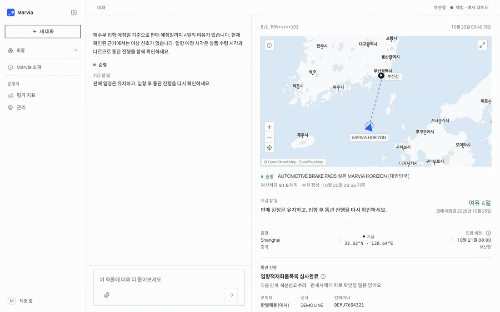
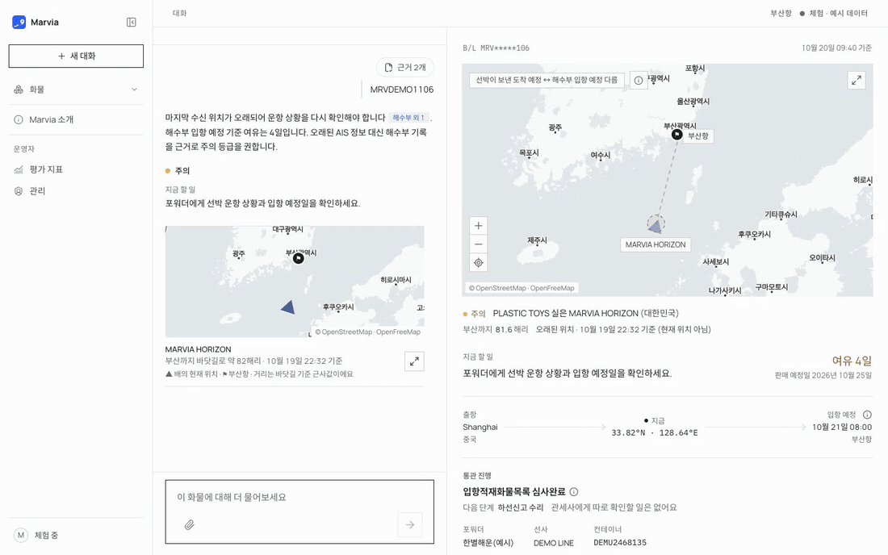
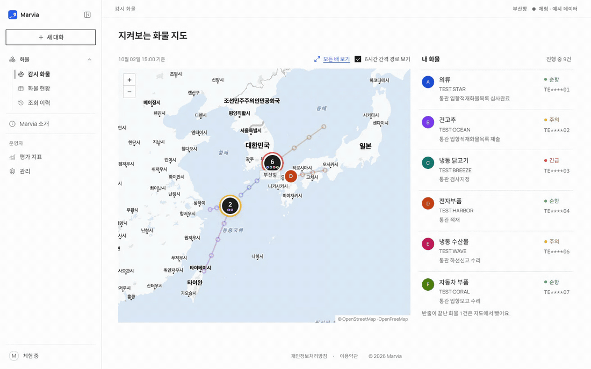
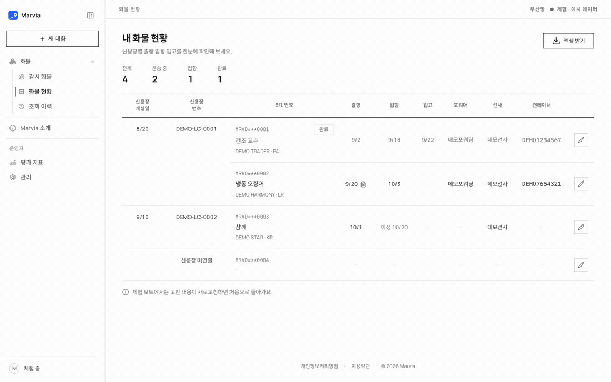
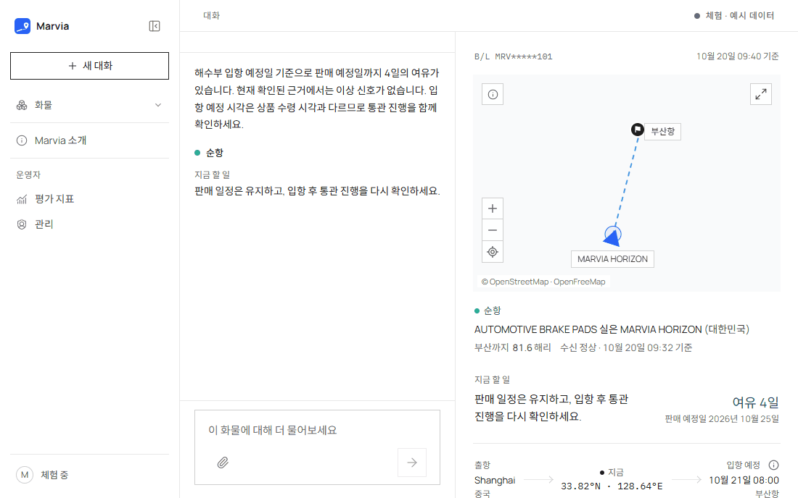
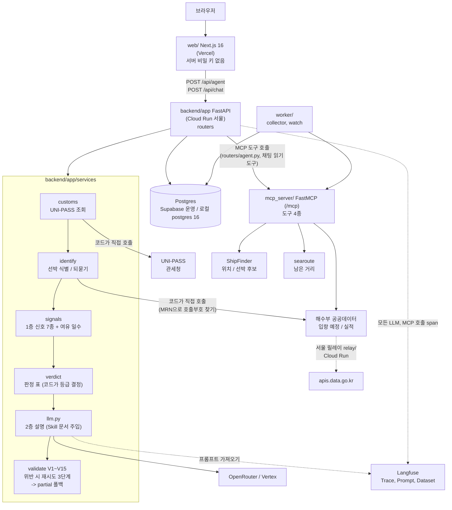
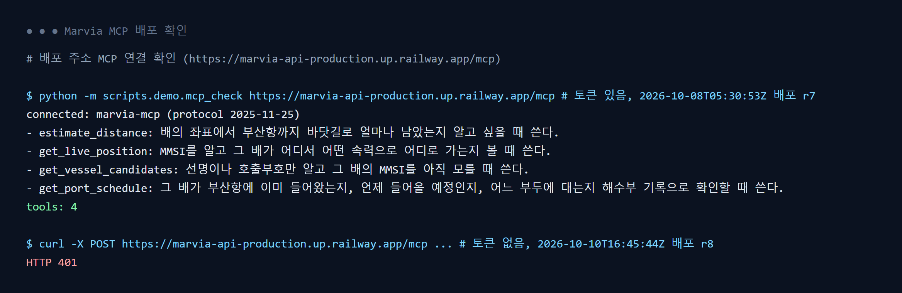

# Marvia (마르비아)

**B/L 하나로 부산항 수입 화물이 제때 오는지 순항 / 주의 / 긴급으로 판정하고, 그 근거를 함께 보여주는 LLM 에이전트.**

KDT AI Human 7기 2차 팀 프로젝트 · 5조 · [유형 1] 도메인 특화 LLM 서비스. 2026-10-20부터 개인 저장소(HJU5022/Marvia)에서 이어 개발한다.

| | |
|---|---|
| 화면 | https://marvia-kappa.vercel.app (Vercel). 로그인 화면의 **데모 계정으로 둘러보기** 버튼으로 바로 들어간다. 데모 계정은 여러 사람이 같이 쓰는 계정이라 대화·화물 기록이 서로 보인다 ([docs/specs/demo-account.md](./docs/specs/demo-account.md)) |
| Agent API | https://marvia-api-898187792720.asia-northeast3.run.app (Google Cloud Run 서울, 재생 모드) (`POST /api/agent`, `POST /api/chat`, `GET /health`, `/docs`) |
| MCP | 위 API 주소의 `/mcp` (Bearer 토큰. 토큰 없이 부르면 401) |
| 상태 | 2026-10-30 확인: 화면 200, API `/health` `{"status":"ok","db":"ok"}`, `/mcp` 401. API가 올라가 있는 GCP 무료 크레딧은 2026-12-09에 끝나고 그 뒤 운영 여부는 정하지 않았다. 주소가 죽어 있으면 [키 없이 데모](#키-없이-데모-13건)로 로컬에서 같은 판정을 재현한다 |
| 평가 리포트 | [EVAL_REPORT.md](./EVAL_REPORT.md) |
| 문서 지도 | [docs/README.md](./docs/README.md) (PRD · SDD · 작업 리스트 · ERD · ADR · 근거 자료) |

2차 제출(2026-10-09, r8)까지는 Railway에 배포했고 그때 주소와 커밋은 [docs/release_manifest.json](./docs/release_manifest.json)에 있다([ADR 0009](docs/adr/0009-deploy-railway-not-vercel.md), 대체됨). 발표 뒤 Railway를 해지하고 개인 계정으로 옮겨 화면은 Vercel, API는 Cloud Run 서울에 **재생 모드**로 공개한다. 바꾼 경위와 대가는 [ADR 0021](docs/adr/0021-deploy-vercel-cloudrun-replay.md)에 있다.

### 살아 있는지 확인

```bash
curl -s https://marvia-api-898187792720.asia-northeast3.run.app/health
```

| 결과 | 뜻 |
|---|---|
| `{"status":"ok","db":"ok"}` | API와 DB가 모두 응답한다 |
| HTTP 503 | API는 떠 있고 DB 연결이 끊겼다 (`/health`가 DB를 확인한다) |
| API 주소 `/`가 `Not Found`, `/api/agent`가 `Method Not Allowed` | 정상이다. API 서버라 첫 화면이 없고 `/api/agent`는 POST만 받는다. 화면은 화면 주소에서 쓴다 |
| 응답 없음 · 타임아웃 | 배포 서버가 내려가 있다. [키 없이 데모](#키-없이-데모-13건)로 같은 판정을 로컬에서 재현한다 |

## 데모

화면 데모 모드(`NEXT_PUBLIC_API_BASE` 비움, 가공 데이터 `MRVDEMO..`)를 실제로 조작해 녹화했다. 실제 B/L은 나오지 않는다.

| 구간 | 보여주는 것 | GIF |
|---|---|---|
| 01 | B/L 조회 → 판정(순항/주의/긴급)과 근거 |  |
| 02 | 배를 확정 못 할 때 되묻기와 후보 칩 |  |
| 03 | 채팅 후속 질문(통관 단계, 다음 할 일) |  |
| 04 | 지켜보기 지도 |  |
| 05 | 서류 사진 첨부 흐름 (데모 모드는 사진 내용과 관계없이 가공 B/L을 돌려준다) |  |
| 06 | 화물 현황표 |  |
| 07 | 실패 흐름: 통관 정보를 못 가져오면 판정 없이 실패와 다시 조회하기, 위치 근거가 모자라면 판정을 미루고 마지막 수신 위치와 해수부 근거만 보여 주는 부분 응답 |  |

---

## 문제와 해결

**문제.** 포워더가 일일이 챙겨주지 않는 소량 해상 수입자(스마트스토어 수입 셀러, 구매대행)는 부산항으로 들어오는 화물 몇 건을 직접 관리한다. 추적 서비스에 ETA가 떠 있어도 **그 값을 믿어도 되는지, 그 배가 내 배가 맞는지, 유니패스 통관 단계가 무슨 뜻인지** 판단하지 못한다. 그래서 포워더 문의와 직접 확인에 시간을 쓰고, 지연을 늦게 알아 판매 일정이 틀어진다.

실제 AIS 데이터는 자주 깨져 있다. ShipFinder 응답에서 직접 확인한 사례는 다음과 같다.

| 사례 | 문제 |
|---|---|
| 53일 전 위치를 현재 위치처럼 반환 | 오래된 값을 믿게 됨 |
| 같은 선명으로 검색하면 국적이 다른 동명 선박이 섞임 | 남의 배를 내 배로 착각 |
| IMO 하나에 MMSI 2개 | 식별 불확정 |
| 목적지가 "XX QZQZZZZZ"처럼 깨짐 | 목적지 신뢰 불가 |
| 항해상태는 "항해 중"인데 속도 0 | 신호끼리 어긋남 |

판정 기준(Skill)은 해군 함정에서 AIS·항해 상태·입출항 절차를 다룬 판독 경험을 옮긴 것이다. 군함 데이터는 기밀이라 같은 해운 도메인의 상선 공개 데이터로 대입했다.

**해결.** B/L 번호와 판매 예정일(선택)을 넣으면 선박을 식별하고 신호를 판정해 3단계 판정과 할 일, 근거를 돌려준다. 배를 확정할 수 없으면 판정하지 않고 되묻는다. 모든 판정에 출처와 조회 시각이 붙는다.

```
입력   B/L 번호 + 판매 예정일 10/20

출력   주의
        근거  AIS ETA 10/14 vs 해수부 입항예정 10/15 09:00 → 12시간 넘게 차이
              해수부 관제 정보를 우선해 신뢰 ETA 10/15, 판매 예정일까지 여유 5일
        할 일 10/13에 다시 확인. 입항예정이 10/18 이후로 밀리면 판매 일정 조정
        통관  "입항 전" 단계, 입항 후 수입신고 → 심사 → 수리 순서
        근거 카드  ShipFinder 위치 (조회 시각) · 해수부 입항예정 (조회 시각) · UNI-PASS (조회 시각)

되묻기 선명 "TEST PAN"(가상) 후보 3척, 국적·목적지로도 확정 불가
        → 판정 없이 "항차 번호나 포워더가 알려준 ETA를 알려주세요"
```

(위 출력은 형식 예시다. 실제 값은 조회 결과에 따라 달라진다.)

판정은 3단계이고, 배를 확정 못 하면 판정 대신 되묻는다. 화면 용어와 코드 값은 다음처럼 대응한다.

| 판정 (코드 값) | 대표 상황 |
|---|---|
| 긴급 (`act`) | 정박 24시간 이상, 목적지가 부산 아님, 통관 검사 지정, 신뢰 ETA가 판매 예정일을 넘김 |
| 주의 (`watch`) | 신호 하나가 켜졌지만(triggered) 여유 일수가 남음 |
| 순항 (`fine`) | 모든 신호 clear, ETA 근거 2개 이상 일치 |
| 되묻기 (status `insufficient`) | 선박 식별 불확정 또는 위치 없음. 판정 없이 물을 것 1개 이상 |

유사 서비스(트레드링스)와 다른 점은 **선박 식별 되묻기**와 **신호 상충 해석** 둘이다. 조회한 배가 내 배라고 전제하지 않고, ETA 확률 범위 대신 왜 못 믿는지 근거를 보여준다. 비교 전체는 [PRD 3장](./docs/Marvia_PRD.md).

**만들지 않는 것:** 항공·육상·부산 외 항만, 창고 수령일 예측, 세액·통관 가부 판단, 결제, 이메일·푸시 알림과 알림톡. 알림은 카카오톡 "나에게 보내기"만 있다. 서류는 사진과 PDF를 받는다. 범위 전체는 [PRD 4절](./docs/Marvia_PRD.md).

---

## 아키텍처



`POST /api/agent`의 처리 단계다. 단계별 입출력과 실패 처리는 [SDD 4절과 8절](./docs/Marvia_SDD.md).

| 단계 | 하는 일 | 누가 |
|---|---|---|
| 1 validate | B/L 형식, 판매 예정일(선택) 검증 | 코드 |
| 2 customs | UNI-PASS 조회 → 선명·국적·통관 단계 | 코드 |
| 3 identify | 후보 1척이면 확정. 여럿이면 선택, 확정 불가면 되묻기 | 코드 + LLM(선택만) |
| 4 collect | 위치·입항예정·남은 거리 | MCP 도구 |
| 5 signals | 1층 신호 7종 (7번째는 판매 예정일이 있을 때) | 코드 |
| 6 margin | 판매 예정일까지 여유 일수 | 코드 |
| 7 judge | 2층 판정 설명·할 일·통관 해설 | LLM (등급은 코드의 판정 표) |
| 8 validate | 출력 검증 규칙, 위반 시 재시도 3단계 | 코드 |

결과는 `AgentResponse`(ok / partial / insufficient / failed)로 나가 화면에 판정·할 일·위치·통관 해설·하역 장소·근거 카드로 그려진다. 채팅(`POST /api/chat`)은 이 흐름 앞에 붙은 자연어 창구라서, B/L이 담긴 문장이면 같은 판정 흐름을 부른다. 채팅 에이전트는 자체 도구 7개(`backend/app/services/chat/tools.py`의 `AGENT_TOOLS`)와 MCP 읽기 전용 도구를 받는다. 대화 목록·기억·지켜보기·카카오톡 알림도 이 창구와 `/api/*` 라우터가 맡는다.

### 설계 원칙

| 원칙 | 내용 |
|---|---|
| 판정은 2층 | 1층은 코드가 신호 7종(위치 6시간 끊김, AIS ETA와 해수부 예정 12시간 차이, 부산 인근 24시간 정박, 목적지 변경·깨짐, 항해상태·속도 불일치, 통관 검사·보류, 신뢰 ETA가 판매 예정일을 넘김)을 triggered / clear / unknown으로 판정한다. 2층은 LLM이 신호가 어긋날 때 어느 출처를 왜 믿는지 설명한다 |
| 숫자는 코드가 계산 | 여유 일수, 거리, freshness는 코드가 계산하고 LLM은 덮어쓰지 못한다. 임계값 원본은 `skills/*/rules.md` 프론트매터 |
| 코드가 LLM을 막는다 | 위치가 오래됐으면 "현재 위치" 표현 금지, 식별 불확정이면 판정 금지, 근거에 없는 숫자 거부 같은 출력 검증 규칙(V1~V15). 위반하면 재시도 3단계 후 폴백. 등급은 코드의 판정 표가 정한다 |
| RAG 아님 | 지식은 Skill 문서를 통째로 넣고, 실시간 데이터는 MCP 도구로 가져온다. LangGraph와 RAG는 쓰지 않는다. 채팅 에이전트의 웹 검색 도구는 "검색 결과 본문을 프롬프트에 붙여 답변 생성"이라 RAG에 해당해 없앴고, 수입 실무 기초는 고정 Skill 문서(`import-basics`)로 옮겼다 ([ADR 0020](docs/adr/0020-remove-web-search-use-skill.md)) |

### Skill 6종 (`skills/`)

각 폴더의 `SKILL.md`(도메인 지식·설명법)와 `rules.md`(코드가 읽는 재료, `import-basics`에는 없다)를 호출에 통째로 넣는다. 어느 호출이 어느 Skill을 받는지는 `backend/app/services/llm.py`의 `JUDGE_SKILLS` 등 상수가 정한다. 폴더 설명은 [skills/README.md](./skills/README.md).

| Skill | 역할 | 넣는 곳 |
|---|---|---|
| `ais-reliability` | AIS 값이 틀리는 경우와 해수부·AIS 출처가 어긋날 때 무엇을 믿는지 읽는 법 | 판정(judge), 선박 고르기(pick), 후속 답(follow-up), 채팅 에이전트 |
| `customs-stages` | UNI-PASS 통관 단계의 뜻·다음 단계·할 일 설명법과 관세사 안내 | 판정, 후속 답, 채팅 에이전트, 통관 해설 채점(평가) |
| `cargo-verdict` | 코드가 낸 등급과 되묻기·보류·실패 결과를 설명하는 법 | 판정, 후속 답, 채팅 에이전트 |
| `port-busan` | 부두·정박지 이름의 뜻과 하역 장소를 한 문장으로 말하는 법 | 후속 답, 채팅 에이전트 (판정에는 넣지 않음) |
| `import-basics` | 수입 실무 기초(B/L 번호를 찾는 곳, 포워더 확인, A/N 같은 낱말) | 후속 답, 채팅 에이전트 (판정에는 넣지 않음) |
| `referrals` | 마르비아가 답하지 않는 부분을 어느 공식 창구에서 확인하게 하는지 | LLM에 넣지 않는다. 채팅 코드(`services/chat/referrals.py`)가 `rules.md`를 읽어 고정 문구 뒤에 붙인다 |

---

## 지표

현재 서비스 모델 `google/gemini-3.5-flash-lite`(OpenRouter)로 평가셋 30건을 6회 돌린 결과다. 프롬프트 라벨 세 가지를 각 2회 쟀고, 코드와 모델은 같고 프롬프트만 다르다. 값은 `evals/results/`의 결과 파일에서 그대로 읽었다.

| 결과 파일 (`evals/results/`) | 프롬프트 | exact | schema_pass | act 재현율 | 선박 오확정 | 통관 해설 | p50 / p95 | 요청당 비용 |
|---|---|---|---|---|---|---|---|---|
| `b_20261007_2102.json` | judge 9 · follow-up 5 | 30/30 | 1.0 | 1.0 | 0 | 20/20 | 2,078 / 6,288 ms | $0.002540 |
| `b_20261007_2110.json` | judge 9 · follow-up 5 | 30/30 | 1.0 | 1.0 | 0 | 20/20 | 1,875 / 5,912 ms | $0.002734 |
| `b_20261007_2105.json` | judge 10 · follow-up 7 | 30/30 | 1.0 | 1.0 | 0 | 20/20 | 1,929 / 5,480 ms | $0.002808 |
| `b_20261007_2113.json` | judge 10 · follow-up 7 | 30/30 | 1.0 | 1.0 | 0 | 20/20 | 1,965 / 3,579 ms | $0.002406 |
| `b_20261007_2107.json` | judge 10 · follow-up 9 (현재 production) | 30/30 | 1.0 | 1.0 | 0 | 20/20 | 1,894 / 5,033 ms | $0.002593 |
| `b_20261007_2116.json` | judge 10 · follow-up 9 (현재 production) | 30/30 | 1.0 | 1.0 | 0 | 19/20 | 1,909 / 4,929 ms | $0.002437 |

- 평가셋 30건 = 정상 8 / 경계 14 / 실패 유도 8 ([evals/dataset.jsonl](./evals/dataset.jsonl)). 사람이 정답을 적었고, 입력은 실제 응답과 형식만 같은 가공값이다. 외부 API는 재생 파일로 대신해 키 없이 돈다. 평가셋 설명은 [evals/README.md](./evals/README.md).
- 지연은 재생 파일 기준이라 실제 외부 호출 시간이 빠져 있다. 비용은 서비스 모델 호출만 센 값이고 채점 모델 호출은 넣지 않았다.
- 통관 해설은 응답에 LLM이 쓴 통관 해설이 있는 문항만 채점 모델(`anthropic/claude-haiku-4.5`, [release_manifest.json](./docs/release_manifest.json)의 `models.eval_grader`)이 0/1로 채점한 값이고, 채점한 문항 수가 분모다(20건). 채점 기준은 [evals/README.md](./evals/README.md).
- 지연·비용은 같은 프롬프트 두 회차 사이 흔들림이 프롬프트 사이 차이보다 커서 프롬프트 효과를 확정하지 못한다.

**게이트:** 결과 파일의 `gates` 4개(act 누락, 선박 오확정, 스키마 통과 95%, 주입 오작동)와 운영 한도 2개(p95 15초 이하, 요청당 비용 $0.005 이하)이고, 하나라도 걸리면 출시하지 않는다. 6회 모두 통과했다 ([EVAL_REPORT 7절](./EVAL_REPORT.md#7-출시-게이트)).

평가 구성은 (a) 규칙만 쓴 베이스라인, (b) 서비스 모델, (c) 비교 모델이다. 등급은 코드 판정 표가 정해서 LLM이 없는 (a)도 verdict_accuracy 1.0, act 재현율 1.0이다(`evals/results/a_20261001_1631.json`). 모델을 가르는 것은 선박 식별, 출력 계약, 통관 해설, 지연·비용이다 ([EVAL_REPORT 3-1절](./EVAL_REPORT.md#3-1-한계와-측정-도구-검증)).

이전 서비스 모델 `openai/gpt-4o-mini`, 비교 모델 `qwen/qwen3-235b-a22b-2507`, 규칙만 쓴 베이스라인과의 비교, 출력 계약 준수율, 프롬프트 개선 전후, 주입 방어 측정은 [EVAL_REPORT.md](./EVAL_REPORT.md)에 있다. Langfuse 기록 집계는 [docs/evidence/langfuse_summary.md](./docs/evidence/langfuse_summary.md).

---

## 실행

API 키가 없으면 [키 없이 데모](#키-없이-데모-13건)부터 한다. 채점에는 이쪽을 권한다.

### 키 없이 데모 13건

키를 하나도 넣지 않고 13건이 끝까지 돈다. 등급(순항·주의·긴급), 되묻기, 반출 완료, 실패는 키 없이 그대로 나오고, 라이브 데모 10건의 설명 문장만 LLM 키가 있어야 나온다. 외부 API 응답은 가공값 재생 파일(`evals/fixtures/replay/`)을 읽는다. 라이브 시연용 모의 화물 10건(`DEMO..`)과 평가셋 데모 3건(`TESTBL..`)이고, 모든 B/L·선박·포워더·컨테이너는 가공값이다.

```bash
git clone https://github.com/HJU5022/Marvia.git && cd Marvia
cp .env.example .env
# .env에서 REPLAY_MODE=false 를 REPLAY_MODE=true 로 바꾼다. 다른 칸은 비워 둔다
docker compose up -d --build
docker compose exec api python -m scripts.demo.make_demo      # 데모 재생 파일을 지금 시각 기준으로 만든다
```

`make_demo`가 B/L 번호와 넣을 판매 예정일을 표로 보여 준다. 판매 예정일은 실행한 날에 따라 달라진다(아래 `<판매일>`).

```bash
curl -s -X POST localhost:8000/api/agent -H 'content-type: application/json' \
  -d '{"bl_no":"TESTBL01","bl_type":"HOUSE","sale_due_date":"<판매일>","session_id":"demo"}'
```

다른 B/L도 `bl_no`만 바꿔 같은 명령으로 부른다. `http://localhost:8000/docs` 화면에서 넣어 봐도 된다.

**평가셋 데모 3건** (키 없이 아래 결과가 나온다)

| B/L | 시나리오 | 기대 결과 |
|---|---|---|
| `TESTBL01` | 정상 | `ok` · 순항(`fine`), 여유 4일. 판정 설명은 녹화 답(`evals/fixtures/replay/llm/`)을 쓴다 |
| `TESTBL04` | 되묻기 | `insufficient` · 같은 이름 배 2척, 항차나 포워더 입항 예정일을 묻는다 |
| `TESTBL26` | 실패 | `partial` · 위치 조회 권한 없음, 판정 보류 |

녹화 답은 `make_demo` 표의 판매 예정일로 부른 `TESTBL01`에만 맞는다. 다른 날짜를 넣으면 등급은 그대로이고 상태는 `partial`이다 ([evals/fixtures/replay/README.md](./evals/fixtures/replay/README.md)).

**라이브 데모 10건** (시나리오는 `scripts/demo/demo_live.py`의 `SPECS`, 펼친 문항은 `evals/fixtures/demo_live.jsonl`)

아래 기대 결과는 `.env`에 `LLM_MODEL`과 `OPENROUTER_API_KEY`를 넣었을 때다. 라이브 데모에는 녹화 답이 없어서 키 없이 부르면 등급은 표대로 나오지만 상태가 `partial`이고 설명 문장 자리에 "설명 문장은 만들지 못했습니다" 안내가 붙는다. 틀린 설명을 그럴듯하게 보이지 않게 한 것이다.

| B/L | 시나리오 | 켜지는 신호 | 기대 결과 |
|---|---|---|---|
| `DEMOQD2610001` | 칭다오에서 황해 항해 중, 여유 9일 | 없음 | `ok` · 순항(`fine`) |
| `DEMOSH2610002` | AIS ETA와 입항 예정 18시간 차이, 여유 6일 | `eta_conflict` | `ok` · 주의(`watch`) |
| `DEMONB2610003` | 도착 예정이 판매 예정일보다 2일 늦음 | `sales_date_exceeded` | `ok` · 긴급(`act`) |
| `DEMOHC2610004` | 입항·반입 뒤 세관 검사 지정 | `customs_hold` | `ok` · 긴급(`act`) |
| `DEMOTJ2610005` | 부산 30해리 안에서 0.2노트로 30시간 대기 | `anchor_wait` | `ok` · 긴급(`act`) |
| `DEMODL2610006` | 마지막 위치 수신이 10시간 전, 여유 7일 | `position_stale` | `ok` · 주의(`watch`) |
| `DEMOKH2610007` | AIS 목적지가 모지(JPMOJ), 여유 8일 | `dest_changed` | `ok` · 주의(`watch`) |
| `DEMOHP2610008` | 같은 이름 배 2척 | 없음 | `insufficient` 되묻기, 배를 고르면(`resolved_mmsi`) 순항 |
| `DEMOSH2610009` | 입항·수입신고 수리, 컨테이너 3개, 포워더 빈 칸, 여유 5일 | 없음 | `ok` · 순항(`fine`) |
| `DEMOQD2610010` | 반출신고까지 끝난 화물 | (판정 안 함) | `ok` · 순항(`fine`) |

알아 둘 것

- 판매 예정일은 선택이다. 비우면 여유 일수 없이 판정하고 "판매 예정일을 넣으면 여유까지 볼 수 있다"는 안내가 붙는다. `DEMONB2610003`은 판매 예정일이 있어야 긴급이 나온다
- 위치 수신 시각이 "만든 시각 30분 전"이라 약 5시간 반 뒤에는 오래된 위치가 된다. 재생 모드 서버는 4시간마다 재생 파일을 다시 만들고, 직접 돌릴 때는 `make_demo`를 다시 돌린다
- Docker 없이: `python -m scripts.demo.make_demo` 후 `REPLAY_MODE=true uvicorn backend.app.main:app --port 8000`
- 재생 파일과 녹화 답의 구성, 시나리오 추가법은 [evals/fixtures/replay/README.md](./evals/fixtures/replay/README.md)

### 키를 넣고 실제 모드로 띄우기

```bash
cp .env.example .env     # 키를 채운다 (아래 표)
docker compose up        # api :8000 (/api/agent, /mcp), worker, postgres 16
curl http://localhost:8000/health        # {"status":"ok","db":"ok"}. DB가 끊기면 503
```

- DB 표(마이그레이션 `backend/app/db/migrations/` 001~023)는 서버가 켜질 때 `DATABASE_URL`이 있으면 자동으로 만들어진다(`backend/app/main.py` → `db.apply_migrations`). 손으로 돌릴 SQL은 없다.
- worker는 `WORKER_SCHEDULE=off`(기본)이면 안내 한 줄을 남기고 바로 끝난다(`Exited (0)`). 고장이 아니다. 주기 수집은 `on`으로 켠다.
- 한글 경로에서 Docker BuildKit이 죽으면 `DOCKER_BUILDKIT=0 docker compose build` 후에 올린다.
- 서버 로그는 요청 1건이 JSON 한 줄이고, 요청 ID는 응답 헤더 `x-request-id`로도 돌려준다(`backend/app/observability/logging.py`).

| 키 | 어디서 | 없으면 |
|---|---|---|
| `REPLAY_MODE` | `true`면 외부 API 대신 `evals/fixtures/replay/`를 읽는다 (기본 `false`) | |
| `UNIPASS_KEY` | 관세청 UNI-PASS 오픈API | B/L 조회 불가 |
| `SHIPFINDER_KEY` | ShipFinder 스타터 키 | 선박 검색·위치 조회 불가 |
| `DATA_GO_KR_KEY` | 공공데이터포털. 해수부 관제정보·선박운항정보 활용신청 | 입항 예정·실적 조회 불가 |
| `OPENROUTER_API_KEY` / `LLM_MODEL` | openrouter.ai / 서비스 모델 이름 (`google/gemini-3.5-flash-lite`) | `partial`: 판정 표 등급만 나오고 설명 문장 없음 (평가셋 데모는 녹화 답) |
| `LANGFUSE_PUBLIC_KEY` / `LANGFUSE_SECRET_KEY` | Langfuse 프로젝트 설정 | 트레이스 없음 |
| `MCP_TOKEN` | 랜덤 문자열 (`python -c "import secrets; print(secrets.token_urlsafe(24))"`) | `/mcp`가 인증 없이 열린다. 배포에서는 반드시 채운다 |
| `BL_ENCRYPTION_KEY` | `python -c "from cryptography.fernet import Fernet; print(Fernet.generate_key().decode())"`로 한 번 만들고 모든 환경에 같은 값 | B/L 원본을 저장하지 않는다. 잃어버리면 저장된 B/L을 다시 열 수 없다 |
| `SUPABASE_URL` | Supabase 프로젝트 주소 | 로그인이 꺼진다. **채우면 로그인이 필수**가 되어 토큰 없는 `/api/agent` 요청은 401이다. 키 없이 돌릴 때는 비워 둔다 |

나머지 키(기억 모델, 하루 토큰 한도, 회원 정보 암호화, 카카오, 해수부 릴레이, OCR, Vertex)는 [.env.example](./.env.example) 주석에 이름과 설명이 있다.

### 화면, MCP, 테스트, 평가

| 하고 싶은 것 | 명령 |
|---|---|
| Docker 없이 API | `python -m venv .venv && .venv/bin/python -m pip install -r backend/requirements.txt -r backend/requirements-doc.txt` 후 `.venv/bin/python -m uvicorn backend.app.main:app --port 8000` (API와 `/mcp`. 윈도우는 `.venv\Scripts\python`) |
| 화면(web/) | `cd web && npm install && npm run dev` (:3000, Node 20.9 이상). `web/.env`의 `NEXT_PUBLIC_API_BASE`를 비우면 가공 데이터로 뜨고, `http://localhost:8000`을 넣으면 위 API에 붙는다. [web/README.md](./web/README.md) |
| MCP 확인 | `python -m scripts.demo.mcp_check http://localhost:8000/mcp` (연결과 도구 목록), `python -m scripts.demo.mcp_demo` (도구 호출), `python -m scripts.demo.mcp_auth_check` (토큰 없으면 401) |
| 테스트 | `pytest backend/tests mcp_server/tests`. 키 없이 가공 응답으로 돈다. PR 때 `.github/workflows/tests.yml`이 같은 범위를 돈다 |
| 평가 | `python -m evals.run_eval --config a\|b\|c` → `evals/results/<config>_<시각>.json`. 실제 API·LLM을 불러 돈이 든다 |

### MCP

| 항목 | 내용 |
|---|---|
| 위치 | API 서버 안의 `/mcp` 경로(FastMCP, Streamable HTTP). 서버 하나로 `/api/agent`와 `/mcp`가 같이 열린다 |
| 인증 | `MCP_TOKEN`을 채우면 `Authorization: Bearer <MCP_TOKEN>` 없이는 401. 배포 주소 확인 기록은 [docs/evidence/mcp-02-deployed-tools.txt](./docs/evidence/mcp-02-deployed-tools.txt), 화면은 아래 그림(둘 다 2차 제출 때 Railway 주소 기록). 지금 Cloud Run 주소도 토큰 없이 `/mcp`를 부르면 401이다(2026-10-30 확인) |
| 도구 4종 (읽기 전용) | `get_vessel_candidates`, `get_live_position`, `get_port_schedule`, `estimate_distance` |
| 서비스가 부르는 방식 | `/api/agent`와 채팅도 도구를 MCP 프로토콜로 부른다(`backend/app/services/mcp_client.py`). 호출마다 Langfuse에 `mcp:<도구>` 관측이 남는다 |



본체·등록 위치와 연결 방식은 [mcp_server/README.md](./mcp_server/README.md).

---


## 배포

지금 공개 배포(2026-10-26~)는 개인 계정에 있고 **재생 모드**(`REPLAY_MODE=true`)다. 외부 API(UNI-PASS·ShipFinder·해수부)는 재생 파일(`evals/fixtures/replay/`)을 읽는다. 재생 모드여도 `LLM_MODEL`이 설정돼 있으면 설명 문장은 실제 모델을 부른다(`backend/app/services/llm.py`의 재생 모드 주석). 2차 제출 때의 Railway 배포는 실제 모드였다([ADR 0010](docs/adr/0010-deployed-server-real-mode.md), 대체됨). 바꾼 경위는 [ADR 0021](docs/adr/0021-deploy-vercel-cloudrun-replay.md).

| 서비스 | 플랫폼 | 비고 |
|---|---|---|
| 화면 | Vercel | `web/` Next.js 16. `NEXT_PUBLIC_API_BASE`가 아래 API를 가리킨다 |
| API | Google Cloud Run (서울, asia-northeast3) | FastAPI. `/api/*`, `/mcp`, `/health` |
| 워커 | 올리지 않았다 | 자동 수집·감시 재판정은 돌지 않는다 |
| DB·로그인 | Supabase (서울) | 2차 때의 팀 프로젝트가 아니라 새 프로젝트다. 표는 같은 마이그레이션으로 만들었다 |

API가 올라가 있는 GCP 프로젝트는 무료 체험 크레딧이고 2026-12-09에 끝난다. 그 뒤 운영 여부는 정하지 않았다. 배포 커밋·확인 결과는 [docs/release_manifest.json](./docs/release_manifest.json) `_current_deploy`에 적는다.

### 이전 배포 (2차 제출, Railway, 해지됨)

2차 제출 때 배포 서버는 실제 모드(`REPLAY_MODE=false`)였다. 아래 표와 명령은 그때 기록이고 지금은 쓰지 않는다. 주소는 모두 404다.

| 서비스 | 플랫폼 | 비고 |
|---|---|---|
| `marvia-web` | Railway | Next.js 16 화면 |
| `marvia-api` | Railway | `Dockerfile.railway` (app 단계만). `/api/*`, `/mcp`, `/health` |
| `marvia-worker` | Railway | 위치·입항 실적 수집, 지켜보는 화물 재판정. 배포에서는 한 번만 실행하고 자동 수집·재판정은 꺼 두었다(`WORKER_SCHEDULE=off`, `WATCH_ENABLED=off`) |
| `mof-relay` | Google Cloud Run (서울) | 해수부 API 릴레이 ([relay/README.md](./relay/README.md)) |

배포는 Railway CLI로 했다(GitHub에서 자동 배포되지 않았다). 레포 루트에서 실행했다.

```bash
railway up --service marvia-api --detach                     # Railway 변수 RAILWAY_DOCKERFILE_PATH=Dockerfile.railway
railway up web --path-as-root --service marvia-web --detach  # web 폴더만 올린다
```

CLI는 연결한 폴더 전체를 올린다. web에 `--path-as-root`가 없으면 루트 `Dockerfile`의 마지막 단계(worker)가 빌드돼 화면이 502가 됐다. 배포한 커밋, 모델, 프롬프트 버전, 확인 결과, 되돌리기 방법은 [docs/release_manifest.json](./docs/release_manifest.json) r8 이하에 있다.

**해수부 릴레이.** 2차 제출 때 Railway 서버(리전 기록은 Singapore)에서 해수부 API가 ConnectTimeout(15초 x 3회)으로 실패했다. 한국에서는 0.1초에 응답하고, UNI-PASS는 싱가포르에서도 됐다. 원인은 확인하지 못했다. 그래서 서울(asia-northeast3) Cloud Run에 작은 FastAPI 릴레이를 두고 우회했다.

| 항목 | 내용 |
|---|---|
| 하는 일 | `GET /1192000/VsslEtrynd5/*`, `/1192000/CntlVssl2/*`만 `apis.data.go.kr`로 넘기고, `X-Relay-Token` 헤더가 맞아야 받는다. 쿼리스트링(serviceKey)은 로그에 남기지 않는다 |
| 백엔드 쪽 | `MOF_BASE_URL`(릴레이 주소, 비우면 직접 호출), `MOF_RELAY_TOKEN`(릴레이의 `RELAY_TOKEN`과 같은 값). 연결 실패는 한 번만 바로 다시 시도하고, 그래도 안 되면 15초 동안 해수부 호출을 바로 실패시킨다(`backend/app/clients/mof.py`의 `CIRCUIT_OPEN_SEC`) |
| 확인한 것 | 2차 제출 때(실제 모드) 운영 `marvia-api`가 릴레이를 쓰고, 운영 채팅의 입항 선박 검색이 실제 선박 목록을 돌려줬다("일본에서 1주 안에 부산 오는 수입 화물선" 질문에 43척, [SDD 6.7절](./docs/Marvia_SDD.md#67-해수부-릴레이-cloud-run-서울)). 지속 가동률은 재지 않았다 |
| 비용 | 개인 GCP 프로젝트의 무료 체험 크레딧(팀 계정 아님). 2026-12-09에 끝난다 |

**알려진 한계.** 지금 공개 배포는 재생 모드라 실제 화물을 조회하지 않고, 2차 제출 때 실제 모드로 돌던 서버에서도 실제 사용자 B/L 판정을 사람이 대조한 기록은 없다. 자동 수집과 감시 재판정은 배포에서 돌지 않는다. 나머지 약점은 [EVAL_REPORT 8절](./EVAL_REPORT.md#8-지금-이-서비스의-가장-큰-약점).

### 기술 스택

| 영역 | 사용 |
|---|---|
| Backend | FastAPI, Pydantic v2, Docker, Google Cloud Run 서울 (2차 제출 때는 Railway `marvia-api`) |
| Frontend | Next.js 16, React 19, MapLibre 지도, Vercel (2차 제출 때는 Railway `marvia-web`) |
| LLM | OpenRouter. 서비스 모델 `google/gemini-3.5-flash-lite`, 비교 모델 `openai/gpt-4o-mini`(이전 서비스 모델)·`qwen/qwen3-235b-a22b-2507`. 구조화 출력. `llm.py`에 Vertex(`vertex/` 접두) 경로도 있다 |
| 도구 | FastMCP (Streamable HTTP), ShipFinder, 해수부 공공데이터, searoute |
| 데이터 | Supabase(배포 DB·로그인), 로컬은 PostgreSQL 16 |
| 관측·평가 | Langfuse (Trace, Prompt, Dataset) |

---

## 레포 구조

레포 루트가 Docker 빌드 컨텍스트다. 파일 단위 설명은 각 폴더 README에 있다.

| 위치 | 무엇 |
|---|---|
| `README.md`, `EVAL_REPORT.md` | 소개·실행법·지표, 관측과 평가 리포트 |
| `CLAUDE.md`, `AGENTS.md` | AI 작업 규칙 |
| `Dockerfile`, `Dockerfile.railway`, `docker-compose.yml` | 로컬 compose용 멀티스테이지, Railway API 이미지(2차 제출 때 사용), api·worker·postgres 16 |
| [`backend/`](./backend/README.md) | FastAPI 서버: 라우터, 스키마(계약), 판정·채팅·회원·지켜보기 서비스, 외부 API 클라이언트, 마이그레이션, 프롬프트 사본, 테스트 |
| [`mcp_server/`](./mcp_server/README.md) | FastMCP 서버, 읽기 전용 도구 4종 |
| [`skills/`](./skills/README.md) | LLM이 읽는 도메인 지식 6종 (폴더마다 `SKILL.md` + `rules.md`) |
| `worker/` | 위치·입항 실적 수집, 지켜보는 화물 재판정 |
| [`relay/`](./relay/README.md) | 해수부 API 중계 (서울 Cloud Run) |
| [`evals/`](./evals/README.md) | 평가셋, 재생 파일, 실행기, 채점, 결과 원본 |
| `scripts/` | 손으로 돌리는 스크립트: `demo/`, `eval/`, `ops/` (`ops/`는 실제 DB·계정을 바꾼다. 실행 전 [scripts/ops/README.md](./scripts/ops/README.md)) |
| [`web/`](./web/README.md) | Next.js 16 화면: `/`(대화), `/watch`, `/cargo`, `/history`, `/settings`, `/admin`, `/metrics`, `/about` |
| [`docs/`](./docs/README.md) | PRD, SDD, 작업 리스트, ERD, ADR, 기능 명세, 근거 자료, 프롬프트 버전 기록, 배포 manifest |

---

## 안전·개인정보

| 원칙 | 내용 |
|---|---|
| B/L은 LLM에 넘기지 않는다 | UNI-PASS는 코드가 직접 조회한다. 트레이스와 로그에는 가운데 절반을 `*`로 가린 값만 남긴다 |
| 필요 없는 필드는 안 넣는다 | UNI-PASS 응답의 중량, 세관명, 화주 정보는 LLM과 DB에 넣지 않는다 |
| 컨테이너 번호 | `[CNTR1]` 같은 가린 표시로만 LLM에 준다 |
| 품명(goods_name) | 저장하고 채팅 에이전트 LLM에는 주지만 판정 LLM에는 주지 않는다 |
| 저장 | B/L은 `BL_ENCRYPTION_KEY`, 회원 정보는 `PII_ENCRYPTION_KEY`로 암호화한다 |
| 레포에 올리지 않는 것 | 실제 B/L 번호, UNI-PASS·ShipFinder 응답 원본, `.env`. 테스트용 응답(`evals/fixtures/`)은 실제 응답과 형식만 같은 가공값이다 |
| 키 | `.env`에만 둔다(`.gitignore` 등록). 필요한 키 목록은 `.env.example`에 값 없이 적는다 |
| Secret Scan | GitHub Actions(`.github/workflows/secret-scan.yml`)가 PR의 모든 커밋과 `main` push를 검사한다. 실패하면 키가 커밋된 것이니 해당 키를 재발급한다 |
| 프롬프트 주입 | 도구 응답, AIS 목적지 문자열, 사용자 입력은 데이터로만 다룬다. 측정은 [evals/results/injection/README.md](./evals/results/injection/README.md), [evals/results/e2e_attack_20261008/README.md](./evals/results/e2e_attack_20261008/README.md) |

---

## 데이터 출처와 라이선스

| 출처 | 쓰는 곳 | 라이선스·이용 조건 |
|---|---|---|
| [searoute-py](https://github.com/genthalili/searoute-py) (Gent Halili) | 부산항까지 남은 해상 거리 (`estimate_distance`) | Apache-2.0 |
| [Eurostat SeaRoute](https://github.com/eurostat/searoute) | searoute-py에 들어 있는 항로 네트워크 데이터의 원본 | EUPL-1.2 |
| [pycountry](https://github.com/pycountry/pycountry) | 세관 국적 코드(KR)와 ShipFinder 국적 이름(Korea, Republic of) 대조 (선박 식별) | LGPL-2.1. 수정 없이 import만 한다 |
| ShipFinder API | 선박 후보·실시간 위치 | 내부 연구 목적만. 서면 동의 없이 복사·게시 금지 → 실제 응답은 레포에 넣지 않고 DB에만 둔다 |
| 관세청 UNI-PASS OpenAPI | 화물통관진행정보 | 조회 정보의 복제·타인 제공 금지 (이용약관 15조③) → 실제 응답은 레포에 넣지 않는다 |
| 해양수산부 공공데이터 (관제정보·선박운항정보) | 입항 예정·실적, 접안 시설 | 공공데이터포털 이용허락범위 제한 없음 |

---

## 팀 (5조)

| 이름 | GitHub | 역할 |
|---|---|---|
| 하정운 | @HJU5022 | 조장 · 풀스택 |
| 김승욱 | @seungwook-kim | 풀스택 |

작업 묶음은 A 백엔드·배포 / B MCP·데이터 소스 / C 판정·LLM·Skill / D 관측·수집·평가 / E 프론트엔드이고, 묶음별 담당은 정하지 않고 열린 작업을 누구든 가져간다([작업 리스트](./docs/Marvia_개발_작업_리스트.md)). 묶음 사이는 [SDD 3절](./docs/Marvia_SDD.md)의 계약 C1~C8로만 이어진다. 변경은 브랜치에서 PR을 열고 조원 1명의 approve를 받은 뒤 `main`에 합친다.

### 일정

| 기간 | 작업 |
|---|---|
| 9/22 | 키 발급 4종, 수집 워커 가동, 골격(FastAPI 빈 서버·Dockerfile·/health) |
| 9/23 | 계약(C1~C8) 고정, 평가셋 구성안 |
| 9/24~27 | (추석) 워커 가동 유지, MCP 뼈대, Langfuse 연결, Skill 초안 |
| 9/28~10/2 | 본 구현, 10/1까지 베이스라인 (a) |
| 9/30 | 중간 점검 |
| 10/6~8 | 라벨 확정, 평가 (a)(b)(c), EVAL_REPORT, UI, 데모 영상. **10/8 자정 코드 동결** |
| 10/9~11 | 발표 자료. 코드 수정 없음 |
| 10/12 | 발표 |
