# Marvia DB ERD

기준: `backend/app/db/migrations/001~014` (10-02). 서버가 뜰 때 순서대로 적용한다 (SDD 3.9, `backend/app/db/__init__.py`).
DB는 Supabase Postgres다. 모든 표에 RLS를 켜고 규칙은 두지 않는다. 공개 키(Data API)로는 못 읽고, 백엔드만 표 주인 계정으로 읽고 쓴다 (005).

표 사이에 외래 키(FOREIGN KEY)는 없다. 아래 선은 같은 값으로 이어 읽는 논리 연결이다.
`user_id`는 Supabase 로그인 사용자 ID(UUID 글자)이고, 사용자 표 자체는 Supabase Auth(`auth.users`)에 있다.

```mermaid
erDiagram
    targets ||--o{ positions : "mmsi"
    targets ||--o{ arrival_reports : "call_sign"
    targets ||--o{ control_events : "call_sign"
    AUTH_USERS ||--o{ query_log : "user_id"
    AUTH_USERS ||--o| user_profiles : "user_id"
    AUTH_USERS ||--o| suspended_users : "user_id"
    AUTH_USERS ||--o{ user_cargo : "user_id"
    AUTH_USERS ||--o| user_memory : "user_id"
    AUTH_USERS ||--o{ admin_actions : "target_user_id"
    operators ||--o{ operator_audit : "email_hash"

    targets { text call_sign PK
              int mmsi
              text ship_name
              timestamptz planned_at
              timestamptz selected_at }
    positions { bigserial id PK
                int mmsi
                timestamptz ts
                timestamptz fetched_at
                float lat
                float lng
                real sog
                real cog
                smallint navistat
                text dest
                text destcode
                timestamptz ais_eta
                jsonb raw }
    arrival_reports { bigserial id PK
                      text call_sign
                      text ship_name
                      text ship_kind
                      text stage
                      timestamptz arrival_at
                      text facility
                      text mrn
                      timestamptz fetched_at }
    control_events { bigserial id PK
                     text call_sign
                     text ship_name
                     text kind
                     timestamptz at
                     text facility
                     timestamptz fetched_at }
    query_log { bigserial id PK
                text request_id
                text session_id
                text user_id
                text bl_masked
                text bl_encrypted
                text status
                text verdict
                text vessel_match
                text decided_by
                smallint retry_count
                text model
                text trace_id
                jsonb response
                timestamptz created_at }
    user_profiles { text user_id PK
                    text name_enc
                    text phone_enc
                    text address_enc
                    timestamptz consent_at
                    timestamptz created_at
                    timestamptz updated_at }
    user_cargo { bigserial id PK
                 text user_id
                 text cargo_key
                 text bl_masked
                 text bl_encrypted
                 text bl_type
                 text label
                 text status
                 date sale_due_date
                 date forwarder_eta
                 bigint vessel_mmsi
                 text last_verdict
                 timestamptz last_checked_at }
    user_memory { text user_id PK
                  jsonb items
                  int version
                  jsonb previous
                  timestamptz updated_at }
    suspended_users { text user_id PK
                      text suspended_by
                      text reason
                      timestamptz suspended_at }
    operators { text email_hash UK
                text email_enc
                text email_masked
                text granted_by
                timestamptz granted_at
                text revoked_by
                timestamptz revoked_at }
    operator_audit { bigserial id PK
                     text action
                     text actor_user_id
                     text target_email_enc
                     text target_email_masked
                     text actor_email_enc
                     text actor_email_masked
                     timestamptz created_at }
    admin_actions { bigserial id PK
                    text action
                    text target_user_id
                    text target_email_masked
                    text actor_user_id
                    text actor_email_enc
                    text actor_email_masked
                    text reason
                    timestamptz created_at }
```

`user_cargo`는 칸이 많아 그림에는 일부만 그렸다. 전체는 아래 표에 있다.

## 소스 사용 현황 (10-02 조사, 코드의 SQL 기준)

| 표 | 쓰는 곳 | 읽는 곳 | 상태 |
|---|---|---|---|
| query_log | routers/agent.py `_logged` | db `recent_queries`(이력 화면), `latest_response`(후속 질문), 탈퇴 삭제 | 사용 중 (칸 일부 미사용) |
| user_profiles | services/profile.py | profile.py, 운영자 고객 목록, scripts/rekey_personal_data.py | 사용 중 |
| suspended_users | services/customers.py | auth.py 요청마다 확인, 고객 목록 | 사용 중 |
| operators | services/operators.py | 운영자 판단, 운영자 목록 | 사용 중 (옛 평문 칸 남음) |
| operator_audit | services/operators.py | 운영자 화면 이력 | 사용 중 (옛 평문 칸 남음) |
| admin_actions | services/customers.py | 운영자 화면 이력 | 사용 중 (옛 평문 칸 남음) |
| schema_migrations | db/__init__.py | db/__init__.py | 사용 중 |
| targets | worker/collector.py | worker/collector.py, `purge_old_positions` | 사용 중 (worker 전용) |
| positions | worker/collector.py | db `recent_positions`(정박 대기 신호), worker | 사용 중 (칸 일부만 읽음) |
| arrival_reports | worker/collector.py | 없음 | 쓰기만. 서비스는 해수부 API를 실시간으로 부른다 |
| control_events | worker/collector.py | `purge_old_positions`만 | 쓰기만. 서비스는 해수부 API를 실시간으로 부른다 |
| user_cargo | 없음 | 없음 | 표만 있음 (014, 기억 기능 미구현) |
| user_memory | 없음 | 없음 | 표만 있음 (014, 기억 기능 미구현) |

### 삭제 후보
| 대상 | 이유 |
|---|---|
| query_log.retry_count | 쓰는 코드도 읽는 코드도 없다. 늘 NULL |
| operators.email, operator_audit.target_email·actor_email, admin_actions.actor_email | 013에서 지문·암호문으로 옮기고 비운 옛 평문 칸. 옮기는 스크립트만 읽는다. 비어 있는지 확인한 뒤 지운다 |
| user_cargo, user_memory | 읽고 쓰는 코드가 없다. 동결(10/8) 전에 기억 기능을 만들지 않으면 지우거나 "미구현"으로 둔다 (팀 결정) |
| arrival_reports, control_events | 서비스가 읽지 않는다. 입항 실적 연구(사후 적중, 작업 D6)에 쓸 계획이 없으면 수집을 멈추고 지운다 (팀 결정) |

### 수정 후보
| 대상 | 이유 | 고칠 방향 |
|---|---|---|
| query_log.model | 이력 화면 API가 읽지만 저장하는 코드가 없어 늘 NULL | `_logged`에서 판정 모델을 저장하거나 칸을 지운다 |
| query_log.bl_encrypted | 저장만 하고 읽는 곳이 없다 (메모리의 다시 조회가 쓸 예정이었음) | 기억 기능을 안 만들면 저장도 멈춘다. 개인 식별 값이라 쓰지 않는 사본은 줄이는 게 낫다 |
| positions.cog·navistat·dest·destcode·ais_eta·raw | 서비스는 ts·lat·lng·sog만 읽는다 | 연구용이면 유지. raw(ShipFinder 원본)와 dest(자유 문장)는 쓸 계획이 없으면 저장을 멈춘다 |
| 008의 cron 등록 | purge_old_positions 등록을 002와 같은 이름으로 다시 한다 | 동작에는 문제 없음. 정리할 때 한 곳으로 모은다 |

조사 범위는 레포 코드(backend/app, worker, mcp_server, scripts, evals)의 SQL이다. 실제 Supabase에 이 표들이 모두 있고 옛 평문 칸이 비어 있는지는 DB를 직접 봐야 확인된다.

---

## 1. 선박 수집 (worker가 쓴다, SDD 5.10)

### targets: 위치를 받을 대상 선박 (001)
| 칸 | 타입 | 설명 |
|---|---|---|
| call_sign | TEXT PK | 호출부호. 해수부 입항 신고와 ShipFinder 위치를 잇는 값 |
| mmsi | INTEGER | 선박 무선 식별 번호. ShipFinder 검색으로 찾는다. 못 찾으면 NULL이고 위치를 받지 않는다 |
| ship_name | TEXT | 선명 |
| planned_at | TIMESTAMPTZ | 대상으로 고를 때 본 부산 입항 예정 시각 |
| selected_at | TIMESTAMPTZ | 대상으로 고른 시각 |

### positions: 선박 위치 이력 (001, 002)
| 칸 | 타입 | 설명 |
|---|---|---|
| id | BIGSERIAL PK | 줄 번호 |
| mmsi | INTEGER | 어느 배의 위치인지. targets.mmsi와 이어진다 |
| ts | TIMESTAMPTZ | 배가 위치를 보고한 시각 (ShipFinder last_time). (mmsi, ts)는 중복 없음 |
| fetched_at | TIMESTAMPTZ | 우리가 받아 온 시각 |
| lat, lng | DOUBLE PRECISION | 위도, 경도 |
| sog | REAL | 속력(노트) |
| cog | REAL | 진행 방향(도) |
| navistat | SMALLINT | AIS 항해 상태 코드 (0 항해 중, 1 정박, 5 계류 등) |
| dest | TEXT | 배가 밝힌 목적지 원문. 아무 글이나 쓸 수 있어 LLM에 넘기지 않는다 (SDD 7절) |
| destcode | TEXT | 목적지 항구 코드 (예: KRPUS) |
| ais_eta | TIMESTAMPTZ | 배가 보낸 도착 예정 시각 |
| raw | JSONB | ShipFinder 응답 원본. DB에만 두고 레포에 올리지 않는다 (약관) |

입항 30일이 지난 배의 위치는 `purge_old_positions()`가 매일 지운다 (002, pg_cron).

### arrival_reports: 해수부 입항 신고 (001)
| 칸 | 타입 | 설명 |
|---|---|---|
| id | BIGSERIAL PK | 줄 번호 |
| call_sign | TEXT | 호출부호 |
| ship_name | TEXT | 선명 |
| ship_kind | TEXT | 선박 종류 |
| stage | TEXT | 신고 구분 (최초, 변경, 최종) |
| arrival_at | TIMESTAMPTZ | 신고한 입항 일시. 최종 신고면 실제 입항 시각에 가깝다 |
| facility | TEXT | 신고한 선석 또는 박지 |
| mrn | TEXT | 입항 적하목록 관리번호. UNI-PASS 화물관리번호 앞 11자리와 같아 배를 특정한다 |
| fetched_at | TIMESTAMPTZ | 이 값을 처음 본 시각 |

### control_events: 해수부 관제 실적 (001)
| 칸 | 타입 | 설명 |
|---|---|---|
| id | BIGSERIAL PK | 줄 번호 |
| call_sign | TEXT | 호출부호 |
| ship_name | TEXT | 선명 |
| kind | TEXT | 관제 종류 (입항, 접안, 이안, 투묘, 양묘, 출항) |
| at | TIMESTAMPTZ | 관제 일시. (call_sign, kind, at)는 중복 없음 |
| facility | TEXT | 시설. 박지면 묘박, 선석이면 접안 |
| fetched_at | TIMESTAMPTZ | 받아 온 시각 |

## 2. 조회 이력 (API가 쓴다)

### query_log: 조회 한 번당 한 줄 (003, 004, 006, 007, 008)
| 칸 | 타입 | 설명 |
|---|---|---|
| id | BIGSERIAL PK | 줄 번호 |
| request_id | TEXT | 요청 ID. 로그와 같은 값 |
| session_id | TEXT | 브라우저 세션. 로그인 꺼진 환경에서 사람을 가르는 값 |
| user_id | TEXT | 로그인 사용자 (006). 로그인 꺼진 환경이면 NULL |
| bl_masked | TEXT | 가운데 절반을 *로 가린 B/L (SDD 3.5) |
| bl_encrypted | TEXT | 서버 열쇠로 잠근 B/L 원본 (007, crypto.py). 로그인 사용자만, 다시 조회할 때 쓴다 |
| status | TEXT | 응답 상태 (ok, partial, insufficient, failed, unsupported) |
| verdict | TEXT | 판정 (fine, watch, act). 판정이 없으면 NULL |
| vessel_match | TEXT | 선박 식별 결과 (confirmed, uncertain, none) |
| decided_by | TEXT | 등급을 누가 정했나 (rule: 판정 표, llm: 회색 지대에서 LLM이 올림) |
| retry_count | SMALLINT | 판정 LLM 재시도 횟수 |
| model | TEXT | 쓴 LLM 모델 |
| trace_id | TEXT | Langfuse 트레이스 ID |
| response | JSONB | 응답 전체 (004). 후속 질문이 꺼내 쓴다. 화면 전용 UNI-PASS 처리 내역(customs_detail)은 넣지 않는다 |
| created_at | TIMESTAMPTZ | 조회 시각 |

90일이 지난 줄은 `purge_old_queries()`가 매일 지운다 (008, pg_cron).

## 3. 회원과 기억 (로그인 사용자)

### user_profiles: 회원 정보 (010)
| 칸 | 타입 | 설명 |
|---|---|---|
| user_id | TEXT PK | 로그인 사용자 |
| name_enc | TEXT | 이름. 개인정보 열쇠(PII_ENCRYPTION_KEY)로 잠근 글자만 들어간다 |
| phone_enc | TEXT | 전화번호. 잠근 글자 |
| address_enc | TEXT | 주소. 잠근 글자 |
| consent_at | TIMESTAMPTZ | 수집·이용 동의 시각 (개인정보보호법 제15조). 동의 없이는 저장하지 않는다 |
| created_at, updated_at | TIMESTAMPTZ | 만든 시각, 고친 시각 |

탈퇴하면 이 줄을 지운다 (services/account.py).

### user_cargo: 사용자가 조회한 화물 (014, 읽고 쓰는 코드는 아직 없음)
| 칸 | 타입 | 설명 |
|---|---|---|
| id | BIGSERIAL PK | 줄 번호 |
| user_id | TEXT | 로그인 사용자. (user_id, cargo_key)는 중복 없음 |
| cargo_key | TEXT | B/L 원본의 HMAC 지문. 같은 사용자 안에서 같은 화물을 찾는 데만 쓴다 |
| bl_masked | TEXT | 가린 B/L |
| bl_encrypted | TEXT | 잠근 B/L 원본. 완료 90일 뒤 비울 예정 (아직 구현 안 됨) |
| bl_type | TEXT | 마스터, 하우스 구분 |
| label | TEXT | 사용자가 붙인 이름표 (예: 고추). 사용자가 준 것만 쓰고 UNI-PASS 품명은 쓰지 않는다 |
| status | TEXT | active(진행 중), done(완료) |
| sale_due_date | DATE | 판매 예정일 |
| sale_due_asked | BOOLEAN | 판매 예정일을 이미 물어봤는지 |
| forwarder_eta | DATE | 포워더가 알려 준 입항 예정일 |
| forwarder_eta_noted_at | DATE | 그 예정일을 들은 날 |
| vessel_mmsi | BIGINT | 확정한 선박 |
| voyage_no | TEXT | 항차 번호 |
| vessel_source | TEXT | 선박을 어떻게 확정했는지 |
| last_verdict | TEXT | 마지막 판정. 다음 조회 때 "지난번엔 지켜볼 것"을 짚는다 |
| last_checked_at | TIMESTAMPTZ | 마지막 조회 시각 |
| last_days_margin | INTEGER | 마지막 여유 일수 |
| last_eta | DATE | 마지막 도착 예정 |
| last_stage | TEXT | 마지막 통관 단계 |
| done_at | TIMESTAMPTZ | 완료 시각 |
| created_at, updated_at | TIMESTAMPTZ | 만든 시각, 고친 시각 |

### user_memory: 사용자 메모장 (014, 읽고 쓰는 코드는 아직 없음)
| 칸 | 타입 | 설명 |
|---|---|---|
| user_id | TEXT PK | 로그인 사용자 |
| items | JSONB | 종류가 정해진 기억 항목 목록. 화면용 마크다운은 코드가 만든다 |
| version | INTEGER | 동시에 고칠 때 나중 것이 앞의 것을 덮지 않게 확인하는 번호 |
| previous | JSONB | 직전 버전. 잘못 고쳐졌을 때 되돌린다 |
| updated_at | TIMESTAMPTZ | 고친 시각 |

### suspended_users: 지금 정지된 계정 (012)
| 칸 | 타입 | 설명 |
|---|---|---|
| user_id | TEXT PK | 정지된 사용자. 요청마다 이 표를 봐서 이미 받은 출입증도 바로 막는다 |
| suspended_by | TEXT | 정지한 운영자 |
| reason | TEXT | 정지 사유 |
| suspended_at | TIMESTAMPTZ | 정지 시각 |

해제하면 줄을 지운다. 지난 정지·해제 기록은 admin_actions에 남는다.

## 4. 운영자

### operators: 운영자 권한 (009, 013)
| 칸 | 타입 | 설명 |
|---|---|---|
| email_hash | TEXT UNIQUE | 이메일 HMAC 지문. 운영자인지 찾을 때 이것만 쓴다 (013) |
| email_enc | TEXT | 잠근 이메일. 운영자 화면에서만 풀어 보여 준다 |
| email_masked | TEXT | 가린 이메일 (예: ks***@g***.com). 열쇠를 잃어도 누구였는지 짐작할 수 있게 |
| email | TEXT | 예전 평문 이메일 칸. 013 이후 비워 둔다 |
| granted_by | TEXT | 등록한 운영자 ID. 스크립트로 넣은 최초 운영자는 bootstrap |
| granted_at | TIMESTAMPTZ | 등록 시각 |
| revoked_by | TEXT | 해지한 운영자 ID. 활성이면 NULL |
| revoked_at | TIMESTAMPTZ | 해지 시각. 활성이면 NULL |

### operator_audit: 운영자 등록·해지 이력 (009, 013, INSERT만)
| 칸 | 타입 | 설명 |
|---|---|---|
| id | BIGSERIAL PK | 줄 번호 |
| action | TEXT | grant(등록), revoke(해지) |
| actor_user_id | TEXT | 처리한 운영자 ID. 스크립트면 bootstrap |
| target_email_enc, target_email_masked | TEXT | 대상 이메일 (잠근 값, 가린 값) |
| actor_email_enc, actor_email_masked | TEXT | 처리한 운영자 이메일 (잠근 값, 가린 값) |
| target_email, actor_email | TEXT | 예전 평문 칸. 013 이후 비워 둔다 |
| created_at | TIMESTAMPTZ | 처리 시각 |

### admin_actions: 운영자가 고객에게 한 일 (011, 012, 013, INSERT만)
| 칸 | 타입 | 설명 |
|---|---|---|
| id | BIGSERIAL PK | 줄 번호 |
| action | TEXT | customer_update(수정), customer_delete(강제 탈퇴), unmask(가린 정보 보기), customer_suspend(정지), customer_resume(해제) |
| target_user_id | TEXT | 대상 고객 |
| target_email_masked | TEXT | 대상 가린 이메일. 탈퇴 뒤에도 누구였는지 남긴다 |
| actor_user_id | TEXT | 처리한 운영자 |
| actor_email_enc, actor_email_masked | TEXT | 처리한 운영자 이메일 (잠근 값, 가린 값) |
| actor_email | TEXT | 예전 평문 칸. 013 이후 비워 둔다 |
| reason | TEXT | 사유. 가린 정보 보기는 필수(10~500자), 수정·탈퇴는 비어 있을 수 있다 |
| created_at | TIMESTAMPTZ | 처리 시각 |

가린 정보 보기(unmask)는 원문을 돌려주기 전에 여기에 먼저 쓴다. 쓰기에 실패하면 원문을 주지 않는다.

## 5. 시스템

### schema_migrations: 적용한 마이그레이션 (`db/__init__.py`가 만든다)
| 칸 | 타입 | 설명 |
|---|---|---|
| name | TEXT PK | 마이그레이션 파일 이름 (예: 014_memory_tables.sql) |
| applied_at | TIMESTAMPTZ | 적용 시각 |

## DB에 넣지 않는 것
- B/L 원본 평문 (가린 값, 잠근 값, 지문만)
- UNI-PASS 품명·중량·세관명·화주 정보 (SDD 3.5, 7절). 화면 전용 처리 내역(customs_detail)도 저장하지 않는다
- 회원 정보와 운영자 이메일 평문
